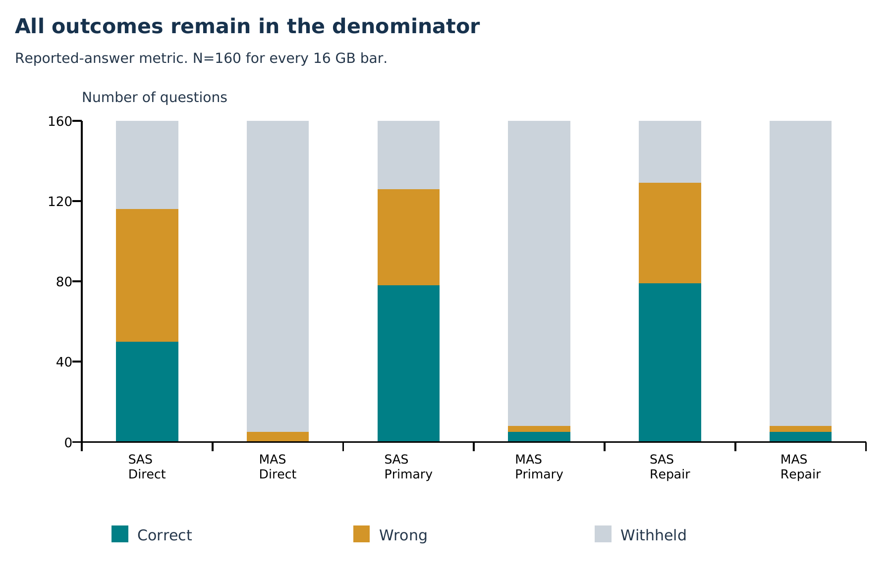
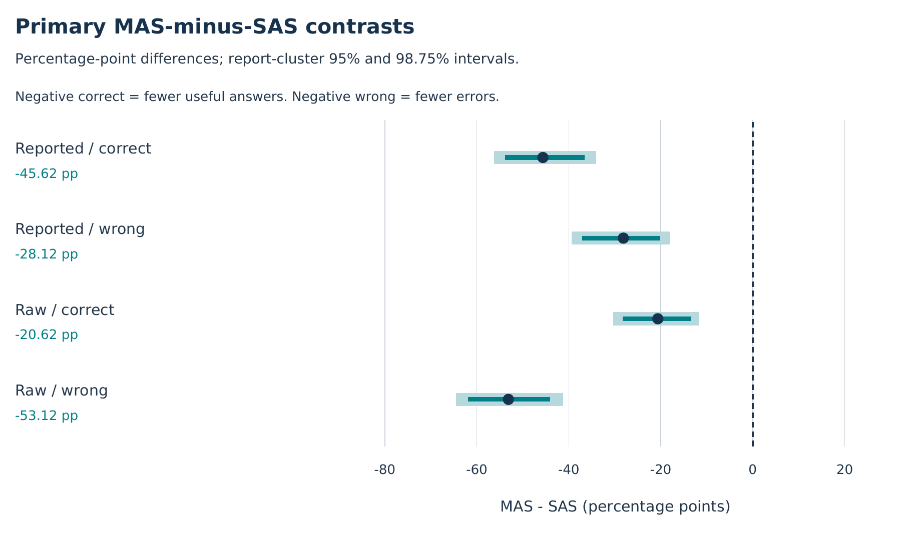
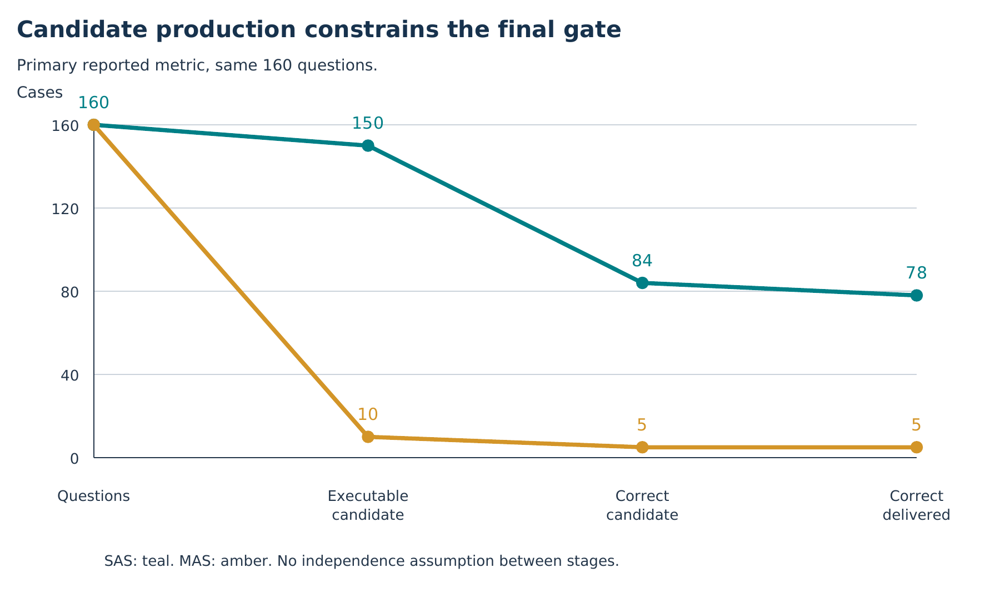
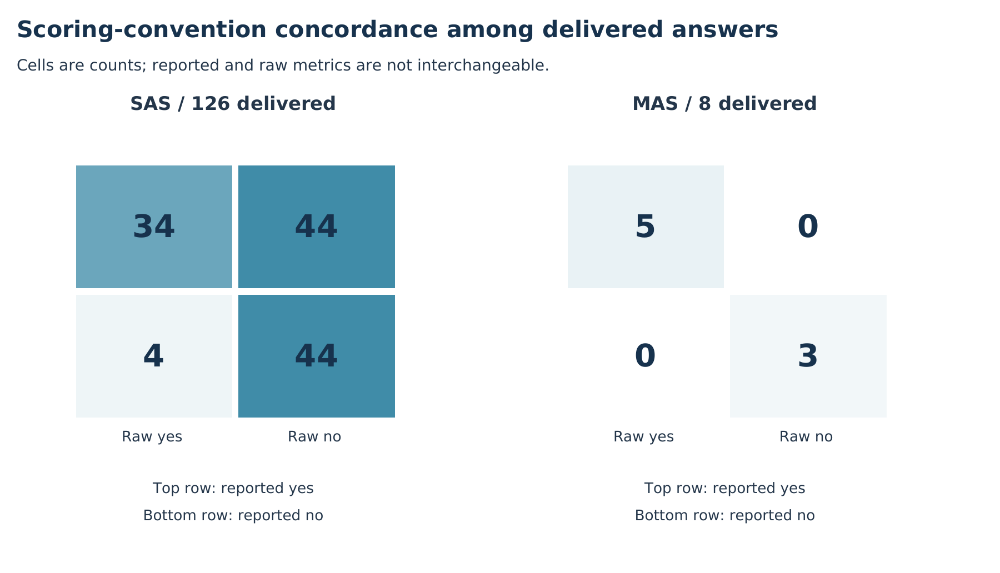
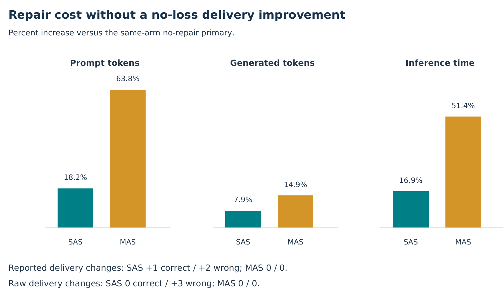
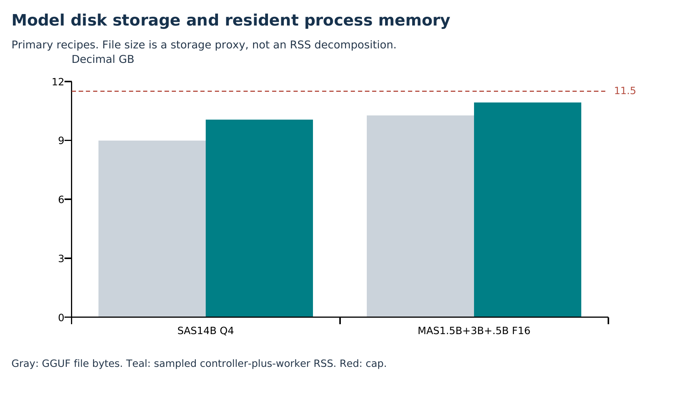

# Phase 3 - Research Implementation and Experimental Evaluation

PHASE 3

Research Implementation and Experimental Evaluation

Project Agere

Quantized Monoliths and Full Precision Specialist Teams for Financial Document Reasoning under Fixed Memory Budgets

Mutasim ur Rehman and Ahmad Raza

Report prepared: 6 November 2026. Experimental evidence completed through 30 October 2026. This report reorganizes existing audited evidence for the seven Phase 3 submission requirements; it adds no model-inference runs.

### Executive summary

A CPU-only Qwen2.5-14B Q4_K_M single-agent system (SAS) was compared with a resident F16 multi-agent system (MAS) comprising 1.5B, 3B and 0.5B specialists. Both received the same financial evidence and deterministic calculator, an 11.5 decimal GB application-memory ceiling and a 2,048 generated-token ceiling per question.

On 160 FinQA questions from 50 held-out company-year reports, SAS delivered 78 correct answers under reported-answer scoring; MAS delivered five. SAS withheld 34 questions, while MAS withheld 152. The team produced fewer wrong deliveries largely by answering only 5% of questions. These results do not support the proposed no-correct-loss advantage for the tested team.

| Submission requirement | Location in this report |
| --- | --- |
| 1. Implementation and methodology changes | Section 1 |
| 2. Dataset, preprocessing and experimental setup | Section 2 |
| 3. Baseline evaluation and essential metrics | Section 3 |
| 4. Graphical results and visualization | Section 4 |
| 5. Comparison with existing research | Section 5 |
| 6. Ablation studies | Section 6 |
| 7. Results analysis and discussion | Section 7 |
| Reproduction and sources | Appendices A-B |

Scope: completed evidence through 16 GB only. Class-feedback incorporation is unverified. Accuracy auditing is complete, but retained swap failures preclude an uninterrupted no-swap deployment claim.

## 1. Implementation of the proposed methodology

### Research problem and gap

Local financial-document assistants must allocate limited workstation memory between model capacity, numerical precision and specialist roles. Earlier agent comparisons commonly vary compute or omit resident-memory constraints. The study asks whether smaller full-precision specialists outperform one larger quantized model under common memory and generation ceilings. The contribution is empirical measurement and diagnosis, not a new inference algorithm.

### Implemented systems

| System / role | Checkpoint | Precision |
| --- | --- | --- |
| SAS: all reasoning and review stages | Qwen2.5-14B-Instruct | Q4_K_M |
| MAS: evidence/source selection | Qwen2.5-1.5B-Instruct | F16 |
| MAS: analysis and program drafting | Qwen2.5-3B-Instruct | F16 |
| MAS: final verification | Qwen2.5-0.5B-Instruct | F16 |

All MAS instances stay resident, without shared backbones. Neither primary 16 GB arm uses task-specific adapters. Both receive identical public evidence, quantity references and arithmetic tools. Role prompts and call counts differ; the experiment compares complete deployment recipes, not isolated architecture or precision factors.

### Architecture and decision flow

| Stage | Implementation |
| --- | --- |
| Shared evidence | Question -> lexical top-eight source units -> quantity catalog |
| SAS generation | One 14B model performs analysis and produces program JSON |
| MAS generation | 1.5B source selector -> 3B analysis and program JSON |
| Shared execution | Resolve source references; apply add/subtract/multiply/divide |
| Review and delivery | 14B SAS or 0.5B MAS reviewer returns PASS/FAIL/UNKNOWN; deliver only ANSWER + valid execution + PASS |
| Scoring | All questions become correct delivered / wrong delivered / withheld |

Programs choose source-linked quantity IDs, prior-step references and whitelisted constants instead of inventing numeric operands. Grammar-constrained JSON controls format. Source binding and deterministic arithmetic do not guarantee correct operand relevance, units or reasoning.

Implementation: scripts/lab_tiers.py; scripts/tier8_v2_financial_pipeline.py; scripts/tier8_v2_finqa.py; scripts/evidence_atoms.py; scripts/evidence_calculator.py. Frozen code/model/data/runtime hashes are in configs/lab_tiers/ and the archived run snapshots.

## 1.1 Changes from Phase 2 and feedback record

The original design targeted KYC/credit workflows across 8, 16 and 32 GB tiers. The completed study preserves the memory-allocation question while narrowing its empirical claims. The prospective scope amendment is retained in research/lab_tiers/PROTOCOL.md; the executed protocol and recovery history remain separate from the original specification.

| Original design | Implemented change and rationale |
| --- | --- |
| Synthetic KYC/credit as principal tasks | Retain 175 historical test cases; use public, program-annotated FinQA for the primary evaluation after auditing synthetic output-contract and task limitations. Numerical QA does not establish KYC compliance. |
| Nominal 12.8 GB process cap at 16 GB | Use 11.5 decimal GB including controller, with a separate host reserve. Reduce common context from 8,192 engineering probes to 4,096 after swap. |
| Task adaptation and hardening | Keep 8 GB adaptation experiments separate. Existing 7B/3B adapters are incompatible with the 14B SAS; both main 16 GB systems are unadapted instruction-tuned checkpoints. |
| Thinking-token parity and three seeds | Enforce an observable 2,048 generated-output-token ceiling; greedy decoding at seed 42. Private reasoning, FLOPs and multi-seed robustness are not measured. |
| Three RAM tiers | Report completed evidence through 16 GB. The 32 GB configuration is specified but unexecuted. |
| Grounding and mismatch outcomes | Preserve historical finance metrics and add correct/wrong/withheld states, coverage and two numerical scoring conventions. |

### Class feedback: provenance limitation

No dated record of the previous class feedback was available in the reviewed project materials. The changes above are supported by development records and measured engineering constraints; they are not attributed to an instructor. Incorporation of specific class feedback remains unverified and must be reconciled with the actual comments before claiming full compliance with that part of the submission requirement.

## 2. Dataset, preprocessing and experimental setup

### Datasets and split isolation

| Evidence regime | Data and role |
| --- | --- |
| Historical 8 GB synthetic | 175 held-out cases: 100 KYC + 75 credit; 150 development cases. Planted mismatches, missing fields and calculator targets. |
| Redeveloped 8 GB FinQA | 52 selection questions and 49 reserved questions, each cohort from 15 reports in the upstream training source; adapted models. |
| Primary 16 GB FinQA | 160 questions, 50 company-year reports, 36 companies, upstream development source. No task-specific fitting. Two fixed demonstrations from the training source. |

For 16 GB, eligible reports are ordered by a fixed salted report-ID hash; the first 50 are selected and every question in each is retained. Reports with recorded earlier development exposure are excluded. Demonstration report overlap is checked. Model-visible packets are sealed before separate scoring payloads are written. This is project-relative report-held-out evaluation, not the official FinQA test split or a guarantee against pretraining contamination.

### Preprocessing and feature engineering

Inputs are structured FinQA JSON, not newly OCR-processed PDFs. Table rows are converted into header-labelled cell text; pre-table and post-table paragraphs become source-ID units. Retrieval lowercases alphanumeric tokens, removes fixed stop words and ranks units by local inverse-frequency weighting with square-root length normalization, capping term occurrences at two. Source IDs break ties and at most eight units are retained.

The shared quantity catalog removes digit-grouping commas, converts parenthesized numeric values to negatives, and assigns finite decimal values deterministic Axxx references with source spans. Gold answers, annotated retrieval, reference programs and supplied model-input fields are excluded from public packets. Gold evidence completeness is used only for post-hoc diagnostics.

### Experimental configuration

Primary host: Linux 7.0, AMD Ryzen 5 8645HS, approximately 15.44 decimal GB visible RAM. Python 3.12; llama-cpp-python 0.3.16 portable AVX2; eight CPU threads; no GPU layers; greedy temperature 0; seed 42; context 4,096; F16 KV cache; use_mmap=False; KV reset each call. Both arms share an 11.5 GB sampled controller-plus-workers RSS ceiling and a 2,048 generated-token ceiling across all stages per case. Equal ceilings do not imply equal actual tokens, FLOPs or energy.

Exact IDs, source revisions and hashes: configs/lab_tiers/protocol.json. Runtime pins: configs/lab_tiers/runtime_pin.json. Historical regimes differ in data, adaptation and backend; do not pool them as a causal RAM-scaling experiment.

## 3. Baseline evaluation and metrics

The principal baseline is the larger quantized SAS. MAS and SAS are run on the same 160 primary questions under three frozen profiles: primary (128-token analysis + two demonstrations, no repair), direct control (no analysis or demonstrations, no repair), and repair (primary plus one full re-plan/re-review). The six jobs yield 960 outputs, not 960 independent questions.

| Endpoint | Definition |
| --- | --- |
| C / W / H | Correct delivered / wrong delivered / withheld; C + W + H = 160 in every job and metric. |
| Coverage / conditional precision | (C + W) / N; C / (C + W). Precision conditions on different delivered sets. |
| Reported-answer correctness | Declared-unit normalization and rounding-aware tolerance against qa.answer. |
| Raw-execution correctness | Absolute error <= max(0.00001, 0.00001 x absolute reference), against qa.exe_ans, without declared-unit normalization. |
| Deployment cost | Generated/prompt tokens, inference seconds, sampled process-tree RSS and swap. |

Reported-answer scoring removes commas and dollar signs, normalizes percentage units, and applies half a final stated decimal unit as tolerance (at least 0.00001). Integer percentages allow half a percentage point before normalization. Incompatible declared units fail. Neither convention is official FinQA program-equivalence scoring. These rules are implemented in reported_reference() and evaluate_financial().

| Profile / arm | Reported C/W/H | Raw C/W/H | Hours | Peak GB |
| --- | --- | --- | --- | --- |
| primary / SAS | 78 / 48 / 34 | 38 / 88 / 34 | 11.546 | 10.062 |
| primary / MAS | 5 / 3 / 152 | 5 / 3 / 152 | 2.432 | 10.929 |
| direct control / SAS | 50 / 66 / 44 | 14 / 102 / 44 | 5.266 | 10.040 |
| direct control / MAS | 0 / 5 / 155 | 0 / 5 / 155 | 0.821 | 10.901 |
| repair ablation / SAS | 79 / 50 / 31 | 38 / 91 / 31 | 13.494 | 10.074 |
| repair ablation / MAS | 5 / 3 / 152 | 5 / 3 / 152 | 3.682 | 10.913 |

Every job includes 160/160 questions, including withheld outputs. No context or budget skips were recorded. Completion includes audited continuation after resource failures; it is not an uninterrupted no-swap pass.

## 3.1 Primary results and statistical interpretation

| Primary metric | SAS | MAS |
| --- | --- | --- |
| Reported correct delivery / all questions | 78/160 (48.75%) | 5/160 (3.125%) |
| Raw correct delivery / all questions | 38/160 (23.75%) | 5/160 (3.125%) |
| Wrong reported deliveries | 48/160 (30.00%) | 3/160 (1.875%) |
| Coverage | 126/160 (78.75%) | 8/160 (5.00%) |
| Reported precision among deliveries | 78/126 (61.90%) | 5/8 (62.50%) |
| Withholding | 34/160 (21.25%) | 152/160 (95.00%) |

MAS minus SAS is -73 reported-correct deliveries (-45.625 percentage points), -45 reported-wrong deliveries (-28.125 points), and +118 withholdings (+73.75 points). The correct-delivery report-cluster 95% interval is approximately [-53.9, -36.6] percentage points. The raw convention also favors SAS for correct delivery: 38 versus five.

### Uncertainty and analysis protocol

Primary differences are paired over questions. Whole-report cluster bootstrap resamples 50 reports with replacement, retaining all questions in each: 10,000 draws, NumPy default_rng(42), question-weighted percentile intervals. Company clustering over 36 companies, equal-report weighting and leave-one-report-out checks assess sensitivity. Four primary endpoints comprise correct and wrong delivery under both scoring conventions; Holm correction is used for the supplemental primary test family.

Extended statistical tests and strata are post hoc. Case-IID Wilson intervals and McNemar tests are descriptive/sensitivity diagnostics because questions within reports are dependent. No equivalence margin was prespecified; non-significance does not establish equality. Repeated conditions are not independent replicates.

### Historical finance metrics: supporting evidence only

| 8 GB synthetic metric | SAS | MAS |
| --- | --- | --- |
| Valid JSON | 175/175 (100%) | 111/175 (63.4%) |
| Structured invention | 125/175 (71.4%) | 89/111 (80.2%) |
| Claim-level citation grounding | 84.4% | 36.3% |
| Planted mismatch recall | 0/20 | 0/20 |
| Missing-field refusal | 0/59 | 0/59 |

The MAS invention denominator excludes malformed outputs and the metric partly measures output-contract compliance; the invention percentages are not directly comparable. These synthetic measures are not substituted for FinQA numerical correctness.

## 4. Graphical results and visualization





The comparison favors SAS for useful answer delivery. MAS lowers wrong delivery but sacrifices coverage. A single precision or error-rate chart would conceal this trade-off.

## 4.1 Candidate behavior and scoring sensitivity





All program-stage outputs are valid JSON, but this is not evidence of numerical competence. SAS generates 150 executable candidates, of which 84 are reported-correct; MAS generates 10, of which five are correct. The MAS bottleneck therefore occurs before the final gate.

## 5. Comparison with existing research

The following are published reference results, not externally reproduced baselines. FinQANet is the closest dataset-family reference; FinMAN is a specialist-agent reference. Only this project SAS/MAS pair shares the exact questions, scoring and resource ceilings.

| Approach | Dataset / result | Setting and comparability |
| --- | --- | --- |
| FinQANet, RoBERTa-large [1] | FinQA public test: 61.24% execution; 58.86% program accuracy (author-corrected). | Supervised retriever/program generator; official split/scorer; no matched RSS/token limits. |
| FinMAN, 7B ICL [2] | BizBench CodeFinQA: 795 test items; 82.64% test accuracy. | DeepSeek-R1 7B, four-agent cascade. Different benchmark variant, budget and acceptance policy. |
| Agere SAS primary | 160 FinQA dev-source questions: 48.75% reported; 23.75% raw correct delivery. | 14B Q4; 11.5 GB and 2,048 output-token ceilings; 21.25% withheld. |
| Agere MAS primary | Same 160 questions: 3.125% correct delivery under either convention. | 1.5B/3B/0.5B F16; same ceilings; 95% withheld. |

FinQANet values use the authors' 4 May 2022 correction, rather than the original 65.05% execution score; the correction identifies leakage in table-row formatting. FinMAN values are from the published paper, Tables 1-2 and Section 5.1. These references were checked during the 2 November 2026 manuscript revision; this report does not claim a new literature search.

### What a fair comparison permits

Different splits, retrieval methods, training, model families, precision, scoring tolerances and abstention policies prevent a numerical ranking across these rows. FinMAN shows that specialist pipelines can work in another setting; it does not establish their benefit under this workstation-memory constraint. Our negative result likewise does not refute all multi-agent methods.

A matched external comparison requires rerunning the published methods on the sealed cohort with the same limits, or evaluating our system on the official test split with the official scorer. Neither was completed. No state-of-the-art benchmark claim is made.

## 6. Ablation studies

### Ablation A: remove analysis and demonstrations together

Direct control disables the 128-token analysis allowance and both fixed demonstrations while preserving review and no-repair behavior. This tests the shared prompt bundle, not its two components independently.

| Contrast: primary minus direct | Reported C change | Reported W change |
| --- | --- | --- |
| SAS | +28 (50 -> 78) | -18 (66 -> 48) |
| MAS | +5 (0 -> 5) | -2 (5 -> 3) |

The bundle improves observed correct delivery in both arms, with stronger inferential support for SAS. The MAS correct-delivery interval includes zero; the exact case-level diagnostic p-value is 0.0625. Separate analysis-only and demonstration-only inference experiments were not performed.

### Ablation B: add one repair/review cycle

| Contrast: repair minus primary | Reported C / W change | Extra inference time |
| --- | --- | --- |
| SAS | +1 correct; +2 wrong | 1.95 hours |
| MAS | 0 correct; 0 wrong | 1.25 hours |

Under raw scoring, SAS adds no correct answers and three wrong answers. MAS attempts 152 repairs without changing a final delivery state. Repair therefore adds cost without a Pareto improvement in correct and wrong delivery. This is a negative experimental finding and is retained.



## 6.1 Individual-component ablation: final review gate

A post-hoc deterministic replay removes only the final review acceptance rule. It keeps the saved primary candidates and executor fixed and delivers every executable candidate, irrespective of PASS/FAIL/UNKNOWN. Invalid and INSUFFICIENT cases remain withheld. There are no new model calls, regenerated drafts or new measurements of no-review latency/memory.

| Arm / metric | Review on: C/W/H | Review off: C/W/H |
| --- | --- | --- |
| SAS / reported | 78 / 48 / 34 | 84 / 66 / 10 |
| SAS / raw | 38 / 88 / 34 | 44 / 106 / 10 |
| MAS / reported | 5 / 3 / 152 | 5 / 5 / 150 |
| MAS / raw | 5 / 3 / 152 | 5 / 5 / 150 |

MAS review removes two wrong deliveries without sacrificing a correct candidate on these saved drafts. Removing it cannot recover the 150 non-executable/INSUFFICIENT questions. SAS review removes 18 wrong candidates while withholding six correct ones under either numerical convention. The gate has a measurable error/coverage trade-off, but it is not the main explanation for MAS underperformance.

### Ablation interpretation limits

The gate replay is exact for these fixed outputs, not a prospective estimate of how a newly prompted system without a reviewer would behave. No hypothesis test was prespecified for this replay. This component result complements the prompt-bundle and repair experiments; it does not isolate model size, precision, role allocation, retrieval or individual prompt-bundle elements.

Reproduce: python scripts/reporting/gate_ablation.py. Source case-table SHA-256 and all eight arm/metric/gate rows are saved in research/paper/data/gate_ablation.json.

## 7. Results analysis and discussion

### Answer to the research question

For the tested recipes, the larger quantized monolith delivers substantially more correct answers than the resident full-precision specialist team. The proposed operational goal - reducing wrong delivery without losing correct delivery - is not supported. Low MAS wrong-answer counts are accompanied by 95% withholding; similar conditional precision hides radically different usefulness.

### Why the team underperformed

The 3B drafter chooses INSUFFICIENT on 150 of 160 questions. Only 10 candidates are executable and five are correct, so an accept/reject-only verifier cannot close the gap on these fixed drafts. Grammar constraints solve syntax, and the deterministic executor solves arithmetic execution; neither ensures semantic operand selection or a useful program. Splitting memory leaves the program-synthesis role with much less capacity than the SAS checkpoint.

| Phase 2 research gap | What the completed evidence establishes |
| --- | --- |
| Memory-bounded team versus monolith | Addressed for the tested <=16 GB recipes; no 32 GB or universal architecture claim. |
| Confounded baselines | Shared tools, evidence and acceptance rules improve comparability; capacity, precision, roles and internal prompts remain jointly different. |
| Hardening versus verification | Adaptation evidence is separate at 8 GB; repair and fixed-candidate gate contributions are measured, without establishing an optimal verifier. |
| Compliance-aligned evaluation | Coverage-aware C/W/H and historical grounding/mismatch metrics are retained. Zero historical mismatch/refusal performance and public numerical QA do not validate compliance. |

### Strengths and limitations

Strengths include common deployment ceilings, full denominators, paired questions, report/company-aware uncertainty, raw/reported metric sensitivity, negative ablations and preserved failure provenance. Limits include one model family, greedy single-seed decoding, deterministic report selection, one primary benchmark, custom metrics, possible pretraining contamination, post-hoc supplemental analyses and no independent annotation review.

This is a comparison of deployment recipes, not a factorial estimate of architecture or precision. Historical regimes change data, adaptation and serving conditions; they cannot identify a causal RAM-scaling curve. No new inference algorithm or regulatory certification is established.

## 7.1 Efficiency, resource validity and conclusion

| Primary cost | SAS | MAS |
| --- | --- | --- |
| Mean inference seconds / question | 259.78 | 54.73 |
| Inference seconds / reported-correct delivery | 532.88 | 1,751.38 |
| Mean generated tokens / question | 204.11 | 184.43 |
| Mean prompt tokens / question | 4,016.79 | 4,666.71 |
| Sampled peak process-tree RSS | 10.062 GB | 10.929 GB |

MAS is faster per question but spends more inference time per useful correct answer and uses approximately 0.87 GB more sampled peak memory. Fewer parameters do not ensure lower memory when the specialist weights are F16 and the monolith is quantized.



### Resource-failure disclosure

RSS/swap are sampled every 0.2 seconds, not enforced by a hard RSS cgroup cap. The first SAS primary attempt swaps after 145 completed cases (44,011,520 swap bytes). A continuation later swaps after seven direct-control SAS cases (34,430,976 bytes). Retained checkpoints precede the first invalid samples and pass replay; failed attempts remain in provenance. Final continuation uses kernel process-swap prevention and completes all six jobs.

The valid description is completed accuracy auditing with retained resource failures, not an uninterrupted no-swap deployment pass. Sampling cannot exclude between-sample peaks. Future work should rerun the frozen primary pair end to end under prospective swap prevention, test other role allocations/model families, use official benchmark scoring and evaluate the unexecuted 32 GB tier.

## Appendix A. Reproducibility and submission artifacts

Repository: https://github.com/mutasim-rehman/project-agere. This PDF is a dedicated Phase 3 report. RESEARCH_PAPER.md and output/pdf/RESEARCH_PAPER.pdf retain the full manuscript and statistical appendices; SUBMISSION.md maps the complete package. No archival DOI is claimed.

| Artifact | Repository path |
| --- | --- |
| Primary case-level results | research/tier16_v2/data/case_outcomes.csv |
| Statistical effects and stage costs | research/tier16_v2/data/paired_effects.csv and stage_metrics.csv |
| Supplemental statistics and gate replay | research/paper/data/ |
| Frozen experiment/model/runtime pins | configs/lab_tiers/ |
| Portable raw evidence + verification | dashboard_handoff/evidence/ and restore_evidence.py |
| This report builder | scripts/reporting/build_phase3_submission.py |
| Report dependencies | requirements-reporting.txt |

### Verification and table-based re-analysis

```bash
python dashboard_handoff/restore_evidence.py
python -m pip install -r requirements-reporting.txt
python -m unittest discover -s tests -p test_reporting_statistics.py
python -m unittest discover -s tests -p test_paper_statistical_tests.py
python scripts/reporting/paper_statistical_tests.py
python scripts/reporting/gate_ablation.py
python scripts/reporting/build_phase3_submission.py
```

The archive verifier checks checksums without extraction. Use --extract restored_agere to restore original relative paths to a new directory. Derived CSVs support re-analysis without inference. Full inference/vocabulary replay additionally requires omitted pinned model weights, tokenizer assets and runtime; an evidence-only clone is insufficient.

### Fresh inference on a provisioned Linux host

```bash
export AGERE_SSD_ROOT=/path/to/AGERE
bash scripts/lab_tiers.sh preflight --tiers 16 --run-id independent-16
bash scripts/lab_tiers.sh run --tiers 16 --run-id independent-16
```

Use a new run ID and the frozen code/configuration and offline runtime described in LAB_TIERS_OFFLINE.md. Full prompts, stage responses, memory traces, invalid attempts and source hashes remain in the archives/original SSD. Do not replace the pinned inference environment with reporting dependencies.

No new model inference was executed to create this report. Values are drawn from the completed study; the builder checks sample counts and the gate-ablation input hash. Report input hashes are saved alongside the PDF.

## Appendix B. References and source record

[1] Chen, Z., et al. (2021). FinQA: A Dataset of Numerical Reasoning over Financial Data. EMNLP. https://aclanthology.org/2021.emnlp-main.300/ . Corrected baseline: authors' repository, 4 May 2022 update: https://github.com/czyssrs/FinQA#updates .

[2] Liu, C., Liu, Q., Zhu, Z., Fei, H., and Mahanti, A. (2025). David vs. Goliath: Cost-Efficient Financial QA via Cascaded Multi-Agent Reasoning. Findings of EMNLP, 4212-4229. https://aclanthology.org/2025.findings-emnlp.225/ .

[3] Project Agere (2026). Quantized Monoliths and Full Precision Specialist Teams for Financial Document Reasoning under Fixed Memory Budgets. RESEARCH_PAPER.md, submission revision 2 November 2026.

[4] Project Agere (2026). Completed 16 GB results, protocol snapshot, statistical methods, data dictionary and resource audit. research/tier16_v2/; experiments 28-30 October 2026.

[5] Project Agere (2026). Frozen higher-tier protocol and scope amendment. research/lab_tiers/PROTOCOL.md; configs/lab_tiers/protocol.json and freeze.json.

[6] Project Agere (2026). Post-hoc fixed-candidate gate-removal analysis. research/paper/data/gate_ablation.json; scripts/reporting/gate_ablation.py.

### Source interpretation

Tables in this report use project source data and the frozen study reports, except the explicitly attributed published-reference rows in Section 5. Figures are existing project outputs with their source captions retained. Primary results, historical supporting evidence and post-hoc analyses are distinguished. No new independent replication is implied by this report.

### Ethics and use

Client-like KYC/credit packs are synthetic; FinQA material is public financial-report text and tables. The prototypes are advisory research systems. No automated credit/KYC decision or regulatory certification is supported by these findings. Upstream attribution and usage terms continue to apply. Author affiliations, institutional details and any actual class-feedback record should be supplied by the authors where required; none is invented here.
