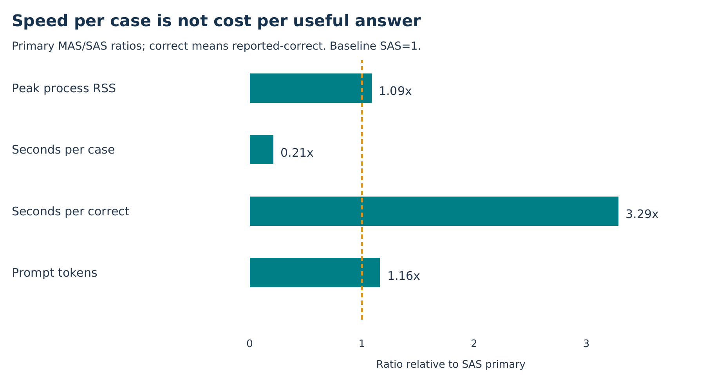

# Project Agere: 16 GB empirical research report

## Spend It Together or Spend It Big? A resource-qualified deployment comparison

**Analysis date:** 30 October 2026. **Evaluation period:** 28-30 October 2026.
**Study status:** completed accuracy audit with retained resource failures.
**Nominal tier:** 16 GB; **physical host:** approximately 15.44 decimal GB available to Linux.
**Application ceiling:** 11,500,000,000 bytes of sampled controller-plus-worker RSS.
**Unique question set:** 160 FinQA questions, 50 company-year reports, 36 companies.
**Repeated outputs:** 960 = 160 questions x 2 arms x 3 profiles; these are not 960 independent questions.
**32 GB:** not evaluated. **New neural calls for these documents:** zero.

## Executive summary

The primary14B Q4 monolith delivers 78 correct reported answers out of 160, versus 5 for the resident F16 specialist team. MAS reduces wrong deliveries from 48 to 3 largely through withholding152 cases. Both recipes fit sampled11.5 GB RSS, but two historical swap failures invalidate an uninterrupted no-swap deployment claim. The completed accuracy evidence and all recovery provenance are retained.

The primary reported-answer contrast is MAS minus SAS: -73 correct deliveries (-45.625 percentage points), -45 wrong deliveries (-28.125 points), and +118 withholdings (+73.75 points). Raw execution gives -33 correct, -85 wrong, and the same +118 withholdings. Both metrics therefore show a correctness-versus-withholding trade-off, not MAS Pareto superiority.

Conditional precision among delivered primary answers is 61.90% for SAS (78/126) and 62.50% for MAS (5/8) under reported scoring. Similar conditional precision conceals radically different coverage: 78.75% versus 5.00%. Under raw execution precision is30.16% for SAS and 62.50% for MAS, again over different selected delivery sets. A small selected denominator is not evidence that MAS solves most questions more reliably.

## 1. Research question and experimental design

The experiment compares complete deployment recipes on the same questions, not isolated architecture, precision or parameter-count factors. SAS uses pretrained Qwen2.5-14B-Instruct Q4_K_M. Resident MAS uses pretrained Qwen2.5-1.5B-Instruct F16 for extraction/source suggestion, 3B F16 for drafting, and 0.5B F16 for verification. All declared MAS model instances stay loaded; there is no role-backbone sharing. Both arms are pretrained: the 8 GB trained adapters are not compatible with the larger SAS checkpoint and are not reused.

Both arms use CPU inference, eight threads, greedy decoding, seed 42, context 4,096 per call, `use_mmap=False`, no GPU layers, the same public evidence packets, and a 2,048 generated-token ceiling per case across stages. Equal ceilings do not mean equal expenditure or equal FLOPs. Prompt-token totals sum all calls and may exceed a single context window. The public packet uses lexical top-eight source-unit retrieval; MAS has the existing source-suggestion stage. Internal prompts/call counts therefore differ.

The primary profile uses the existing 128-token analysis allowance and two fixed training demonstrations, binary review, and no repair. Direct-control removes both analysis and demonstrations. Repair-ablation keeps primary prompting and adds the existing repair/review policy. These are bundled profile contrasts; they do not isolate demonstrations from analysis. No new source catalog, header materialization, adaptive repair method, training or routing was adopted for this evaluation.

All 50 reports were selected by fixed ID hash, excluding recorded earlier development/report exposure; all questions in a chosen report were retained. Scoring annotations were kept separate from sealed public packets. These are public FinQA development-source reports, not the official test split, bank client files, or a guarantee against model pretraining contamination. All output cases remain in denominators, including insufficient answers and withheld outputs.

## 2. Outcome definitions and denominator discipline

For each numerical metric, C means a correct delivered answer, W a wrong delivered answer, and H a withheld answer. Candidate correctness is not delivery: a correct candidate can be withheld. Coverage is (C+W)/N; conditional precision is C/(C+W). A system that withholds everything has zero wrong deliveries and zero useful answers.

The reported-answer metric uses the existing declared-unit normalization and rounding tolerance against `qa.answer`. The raw-execution metric uses the existing relative/absolute tolerance against `qa.exe_ans`, without reported-answer normalization. Neither is an official FinQA program-equivalence implementation. They assess related but different numerical conventions; neither is chosen after seeing which favors an arm. Source-supported execution means the deterministic operand/program checks passed, not that the final answer is financially correct.

## 3. Complete results across all profiles

| Profile / arm | Reported C / W / H | Raw C / W / H | Time (h) | Peak RSS (GB) |
| --- | --- | --- | --- | --- |
| primary / SAS | 78 / 48 / 34 | 38 / 88 / 34 | 11.546 | 10.062 |
| primary / MAS | 5 / 3 / 152 | 5 / 3 / 152 | 2.432 | 10.929 |
| direct control / SAS | 50 / 66 / 44 | 14 / 102 / 44 | 5.266 | 10.040 |
| direct control / MAS | 0 / 5 / 155 | 0 / 5 / 155 | 0.821 | 10.901 |
| repair ablation / SAS | 79 / 50 / 31 | 38 / 91 / 31 | 13.494 | 10.074 |
| repair ablation / MAS | 5 / 3 / 152 | 5 / 3 / 152 | 3.682 | 10.913 |

## 4. Primary paired statistical assessment

| Endpoint | MAS-SAS (pp) | Report 95% CI (pp) | Company 95% CI (pp) | Holm p (4) |
| --- | --- | --- | --- | --- |
| Reported answer / correct | -45.62 | [-53.90, -36.55] | [-53.47, -36.44] | 0.000061 |
| Reported answer / wrong | -28.12 | [-37.09, -20.13] | [-38.36, -19.76] | 0.000061 |
| Reported answer / withheld | +73.75 | [+64.71, +81.93] | [+66.03, +81.10] | not independent test |
| Raw execution / correct | -20.62 | [-28.26, -13.37] | [-28.15, -14.07] | 0.000061 |
| Raw execution / wrong | -53.12 | [-61.90, -44.08] | [-61.99, -43.08] | 0.000061 |
| Raw execution / withheld | +73.75 | [+64.71, +81.93] | [+66.03, +81.10] | not independent test |

The four supplemental sign-flip p-values hit the 65,536-draw resolution floor; Holm-adjusted values are about 0.000061. These depend on symmetry/cluster assumptions and are not exact causal probabilities. Correctness and wrong-delivery contrasts point in opposite operational directions; a small p-value cannot resolve that preference trade-off.

## 5. Where useful answers are lost

| Arm | Executable | Correct candidate | C delivered | W delivered | Correct withheld | Wrong withheld | Invalid withheld |
| --- | --- | --- | --- | --- | --- | --- | --- |
| SAS | 150 | 84 | 78 | 48 | 6 | 18 | 10 |
| MAS | 10 | 5 | 5 | 3 | 0 | 2 | 150 |

All 160 initial program-stage responses parse as JSON objects in both primary recipes. SAS emits150 ANSWER and 10 INSUFFICIENT decisions; MAS emits10 ANSWER and 150 INSUFFICIENT decisions. This is program-stage syntax, not the same whole-workflow metric as the older synthetic report. The known grammar constraint addresses format; it does not ensure useful semantic/program coverage.

Primary SAS produces150 executable candidates, of which84 are reported-correct; review delivers 78 correct and 48 wrong, withholding6 correct candidates and 18 executable wrong ones, in addition to 10 invalid/insufficient outputs. MAS produces10 executable candidates,5 correct; it delivers all 5 correct and 3 wrong, withholding2 wrong and 150 invalid/insufficient outputs. Its final low coverage is therefore not primarily a gate that rejects many correct drafts.

All annotated gold evidence is present in the public retrieval packet on 138/160 questions. Within that stratum SAS delivers 74 correct and has 3 invalid/insufficient outputs; MAS delivers 5 correct and has 128 invalid/insufficient outputs. Among 22 incomplete-retrieval questions, SAS delivers 4 correct and MAS 0. These are post-hoc reference-dependent diagnostics, not deployment routing features or causal evidence. Gold retrieval completeness does not certify reference-program expressibility in the compact catalog.

The analysis stage reaches its intentional128-token limit on 159 SAS and 157 MAS primary cases. These events must not be described as malformed final JSON or context failure: the audited structured generation continues afterward. The summaries record zero context/budget-skipped calls across these six jobs. A smaller context can still change reasoning quality, which this single-context study cannot estimate independently.

## 6. Prompt-profile and repair ablations

| Contrast (right-left) | Metric | Delta C | Delta W | C 95% CI (pp) | W 95% CI (pp) |
| --- | --- | --- | --- | --- | --- |
| sas-reasoned vs direct | Reported answer | 28 | -18 | [+9.76, +24.55] | [-17.98, -3.90] |
| sas-reasoned vs direct | Raw execution | 24 | -14 | [+8.59, +21.62] | [-17.96, +0.72] |
| mas-reasoned vs direct | Reported answer | 5 | -2 | [+0.00, +6.98] | [-5.26, +2.55] |
| mas-reasoned vs direct | Raw execution | 5 | -2 | [+0.00, +6.98] | [-5.26, +2.55] |
| sas-repair vs primary | Reported answer | 1 | 2 | [+0.00, +2.04] | [+0.00, +3.40] |
| sas-repair vs primary | Raw execution | 0 | 3 | [+0.00, +0.00] | [+0.00, +4.35] |
| mas-repair vs primary | Reported answer | 0 | 0 | [+0.00, +0.00] | [+0.00, +0.00] |
| mas-repair vs primary | Raw execution | 0 | 0 | [+0.00, +0.00] | [+0.00, +0.00] |

The reasoned profile changes both analysis allowance and demonstrations together. Relative to direct control, SAS gains28 reported correct deliveries and avoids18 wrong ones; raw execution gains24 correct and avoids14 wrong. MAS gains5 correct and avoids2 wrong under both metrics. These are actual matched profile contrasts, not proof that either component alone causes the change.

Primary and repair-ablation have identical initial answer, execution, score, verdict and plan on all 160 matched cases in both arms. SAS repair adds one reported-correct and two wrong deliveries by releasing previously withheld cases. Under raw execution it adds zero correct and three wrong deliveries. MAS attempts152 repairs yet every final delivery state remains identical to primary; source-supported candidate programs fall from 10 to 8 without a delivered-answer gain.

SAS repair adds about 1.95 inference hours; MAS adds about 1.25 hours. Extra compute is a measured cost, not a benefit or a novel mechanism. The no-repair primary was specified before this complete comparison; it was not selected afterward as the best-looking profile.

## 7. Scoring-convention audit

| Delivered SAS primary | Raw correct | Raw incorrect | Total |
| --- | --- | --- | --- |
| Reported correct | 34 | 44 | 78 |
| Reported incorrect | 4 | 44 | 48 |
| Total | 38 | 88 | 126 |

The primary SAS delivered-answer concordance has 34 correct under both metrics,44 reported-only correct,4 raw-only correct and 44 wrong under both. Thus48/126 deliveries change correctness label across metrics. Primary MAS has 5 correct under both and 3 wrong under both. The reported-versus-raw difference is not simply a subset relation.

For example, `AAPL/2005/page_83.pdf-1` yields26.6667 with declared unit number, matching the rounded reference answer26.7 but not raw `exe_ans=0.26667`. This illustrates source numerical-convention differences; it does not license relabelling all disagreements as model errors or all as annotation defects. All 48 disagreeing cases are exported in `metric_disagreements.csv`. Neither score is labelled official FinQA program equivalence.

## 8. Memory, latency and useful-answer economics

| Arm | Seconds/case | Seconds/reported correct | Generated/case | Prompt/case | Peak GB | Reported precision |
| --- | --- | --- | --- | --- | --- | --- |
| SAS | 259.78 | 532.88 | 204.11 | 4016.79 | 10.062 | 61.90% |
| MAS | 54.73 | 1751.38 | 184.43 | 4666.71 | 10.929 | 62.50% |

SAS uses more inference time per case, but its larger number of useful answers changes the economics. Primary MAS is about 4.75 times faster per case, yet requires roughly3.29 times as much inference time per reported-correct delivery. MAS also uses more primary peak RSS despite fewer nominal parameters:10.93GB versus 10.06GB. The observed memory ordering is compatible with precision/storage trade-offs, not a general theorem that one architecture always uses more memory.

Stage-inference seconds cover committed-case calls and exclude loading, waiting and uncheckpointed/retried work. Across all six jobs they sum to roughly37.24 hours. The last service alone ran a shorter wall-clock interval because it reused327 completed outputs; do not present that service duration as the entire experiment cost. Prompt tokens include repeated evidence across calls, and actual generated-token expenditure differs below the shared ceiling.

## 9. Resource validity and recovery chronology

The application ceiling is 11.5 GB, including the controller. The separate 1 GB host reserve is not additional application usage; recovery adds a 100 MB launch cushion. The earlier 12.49 GB attempt stopped at a reserve check before model inference. Subsequent 8,192-context engineering probes encountered process swap, so the common context was reduced to 4,096 for both arms and tiers before the higher-tier accuracy run. Model weights and precision did not change.

The first SAS primary attempt stopped after 145 completed cases on 44,011,520 bytes of process-tree swap, while sampled peak RSS was 10,056,552,448 bytes. The first continuation later stopped after seven direct-control SAS cases on 34,430,976 swap bytes, with sampled peak RSS 10,039,861,248 bytes. Every reused checkpoint preceded the first invalid sample; the original 145 cases also passed full vocabulary-only prompt, program, score, delivery and token-ledger replay before reuse. No completed cases were selected by quality.

Both complete primary jobs and seven direct-control cases were retained in the final continuation (327 saved outputs at that point). Whole failed attempts remain in hashed provenance, while derived pre-breach prefixes are explicitly labelled as non-independent evidence. The final continuation ran in a user-systemd service with kernel `memory.swap.max=0`; global swap/swappiness settings were unchanged. This prevents research processes from swapping prospectively, but cannot retroactively erase the two earlier failures.

All six final jobs completed and the saved-response audit and export succeeded. The correct status is `complete_accuracy_audited_resource_invalid`, with `uninterrupted_no_swap_deployment_pass=false`. RSS enforcement samples every 0.2 seconds and is not a hard cgroup RSS bound. Passing engineering probes or later clean segments does not establish worst-case memory behavior, absence of between-sample peaks, or an uninterrupted product deployment pass.

## 10. Hypothesis decisions and contribution

The prespecified goal that resident MAS should reduce wrong delivery without losing correct delivery is not supported by the primary16 GB result. Correct-delivery intervals favor SAS under both scoring conventions, while wrong-delivery counts favor a much more withholding MAS. This does not prove universal SAS superiority, accept a global null, establish equivalence, or validate regulatory safety.

The useful research contribution is a reproducible comparison of constrained deployment recipes, a coverage-aware interpretation, candidate/gate decomposition, metric-convention sensitivity and an honest repair/resource audit. No newly invented inference algorithm or globally novel feature is established. Engineering resumability, checksums and process-swap prevention support the measurement; they are not themselves evidence of algorithmic originality.

## 11. Statistical methods and sensitivity

The prespecified primary comparison is the 16 GB primary-profile SAS/MAS pair. Endpoints were specified before evaluation; this extended statistical analysis, its extra tests and multiplicity grouping were written after inspecting results and are supplemental/post hoc. Secondary profiles and older experiments do not become additional chances to declare a favorable primary result.

Primary intervals resample all 50 company-year reports with replacement, retaining every question in each sampled report. The estimator remains question-weighted; sampled denominators vary with report sizes. We use 10,000 draws, NumPy `default_rng(42)`, and linear percentile quantiles. The original audit used Python `random.Random(42)` and different quantile indexing; its exact original JSON is retained. Small numerical interval differences are implementation differences, not different outcomes.

Company-level sensitivity resamples 36 companies, preserving their reports. We also report equal-report estimates and leave-one-report-out ranges. These checks address dependence/weighting sensitivity but cannot establish independence across firms or representative sampling. The ID-hash report selection is not a randomized architecture intervention.

Supplemental cluster sign-flip tests use independent cluster contributions and require sign-exchangeability/symmetry under the null. Nonzero cluster signs are enumerated exactly when at most 18 are present; otherwise 65,536 Monte Carlo sign assignments use seed 42 and p=(extreme+1)/(draws+1). These are not design-randomization causal p-values. At the Monte Carlo floor, p is not zero or infinitely precise. Case-IID exact McNemar results are included only as sensitivity diagnostics; they ignore report dependence.

Holm adjustment is applied to the four primary correct/wrong contrasts across the two metrics. Withholding is determined by the accounting identity and is not a fifth independent endpoint. Secondary tests are labelled exploratory/unadjusted. Bonferroni-style 98.75% bootstrap intervals are also provided for the four primary endpoints; their coverage remains approximate because bootstrap assumptions remain necessary.

Nonsignificance is not evidence of equality. No practical equivalence margin was prespecified, so no TOST/equivalence or noninferiority pass is declared. Zero-event bootstrap degeneracy is not population certainty. Precision comparisons condition on different selected delivery sets and are not interchangeable with matched unconditional accuracy comparisons. No post-hoc observed-power claim is used.

## 12. Limitations and responsible scope

Only one model family, one fixed greedy recipe and one financial numerical benchmark are evaluated at 16 GB. The public development-source sample is report-held-out relative to recorded project exposure, not a clean pretraining holdout or the official FinQA test set. Equal memory/token ceilings do not match actual compute, prompt context, role allocation, training effort or latency.

MAS and SAS differ jointly in model size, precision, number of roles and internal prompts. The 8 GB redevelopment also differs in adaptation, serving mode, question source and CPU backend. Its deployment-budget label does not establish that adaptation training ran on a physically8 GB host. Neither arm is established as the best possible system under its memory ceiling. Consequently neither the 16 GB recipe contrast nor the cross-tier inventory identifies a universal architecture law, a pure precision effect or a causal RAM-scaling slope.

The resource history contains two swap failures; recovered accuracy evidence cannot certify an uninterrupted no-swap product. No bank-client, KYC mismatch or regulatory-safety endpoint is measured in the 16 GB FinQA study. The older synthetic tests do not establish real-world regulatory readiness either. The analysis is not legal or deployment certification.

The added tests, strata, cost sensitivities and theoretical framing are post hoc. They cannot manufacture a new algorithmic contribution or prove population equivalence. Some analytical intervals require independent reports/companies, and deterministic report selection limits design-based generalization. Theoretical results below are conditional mathematical statements about the formalized quantities, not proofs of empirical MAS inferiority.

## 13. Reproducibility and retained evidence

Raw source authority is the immutable SSD run and its checksum-protected result archive. Derived case/report/paired tables are committed separately for analysis; no model weights, private tokens or training environment are copied into the documentation package. The final audit replay reconstructs prompts, programs, delivery decisions, scores and token ledgers from saved model responses. These reports introduce no new generation, training, thresholds, case exclusions or metric changes.

Run the reproducible scripts with a Python environment containing NumPy and ReportLab; the existing bundled desktop runtime supplies both. The analysis script verifies the final audit's input hashes and export checksum before recomputing endpoints. Rendering is a separate presentation step. See `research/tier16_v2/REPRODUCIBILITY.md` for exact commands and artifact maps.

## References and source hierarchy

- [R1] Chen et al. (2021), [FinQA: A Dataset of Numerical Reasoning over Financial Data](https://aclanthology.org/2021.emnlp-main.300/). Benchmark source; the project uses disclosed custom subsets and scoring conventions.
- [R2] Cameron and Miller (2015), [A Practitioner's Guide to Cluster-Robust Inference](https://cameron.econ.ucdavis.edu/research/Cameron_Miller_JHR_2015.pdf). Dependence-aware inference background.
- [R3] American Statistical Association (2016), [Statement on statistical significance and p-values](https://www.amstat.org/asa/files/pdfs/p-valuestatement.pdf). Interpret estimates and assumptions rather than a p-value threshold alone.
- [R4] Lakens (2017), [Equivalence Tests: A Practical Primer](https://doi.org/10.1177/1948550617697177). Equivalence requires an explicit margin and suitable design, not a nonsignificant difference.
- [R5] El-Yaniv and Wiener (2010), [On the Foundations of Noise-free Selective Classification](https://jmlr.org/papers/v11/el-yaniv10a.html). Risk/coverage and rejection are established ideas, not a new algorithm here.
- [R6] Holm (1979), [A Simple Sequentially Rejective Multiple Test Procedure](https://www.ime.usp.br/~abe/lista/pdf4R8xPVzCnX.pdf). Multiple-test control background.
- [R7] Hoeffding (1963), [Probability Inequalities for Sums of Bounded Random Variables](https://www.tandfonline.com/doi/abs/10.1080/01621459.1963.10500830). Independent bounded-cluster inequality background.
- [L1] Authoritative 16 GB audit: `AGERE/runs/lab_tiers_v1/lab-16-115gb-recovery-02/analysis/summary.json`; unchanged copy in `research/tier16_v2/evidence/original_audited_summary.json`.
- [L2] Final derived analysis: `research/tier16_v2/data/statistical_analysis.json`; file hashes and archive checksum in `research/tier16_v2/evidence/input_provenance.json`.
- [L3] Latest 8 GB natural runs: `AGERE/runs/tier8_method_qa/`; matched-study paired audits and secondary closure under `AGERE/runs/tier8_matched_continuation/` and `AGERE/runs/lab_handoff/closure-v1/`.
- [L4] Historical references: `TIER_8_RESEARCH_REPORT.md` and `TIER_8_V2_STATISTICAL_EVALUATION_REPORT.pdf`, retained unchanged. Their earlier snapshots and stronger interpretations do not supersede later raw evidence.
