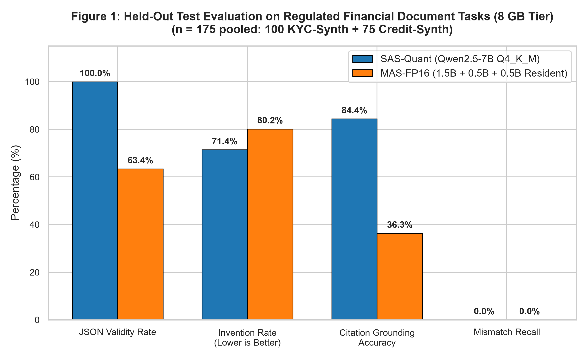
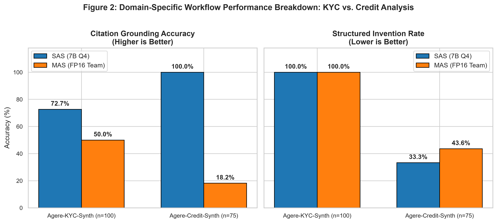
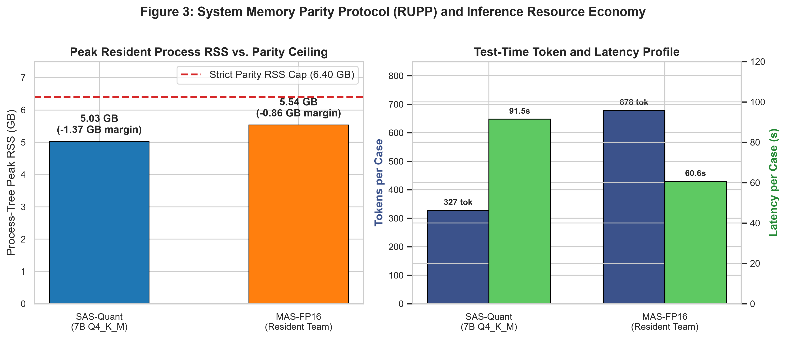
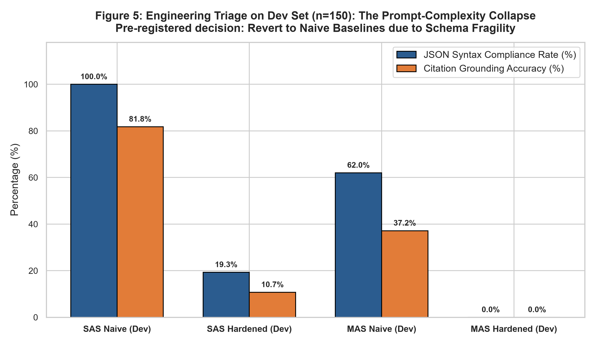
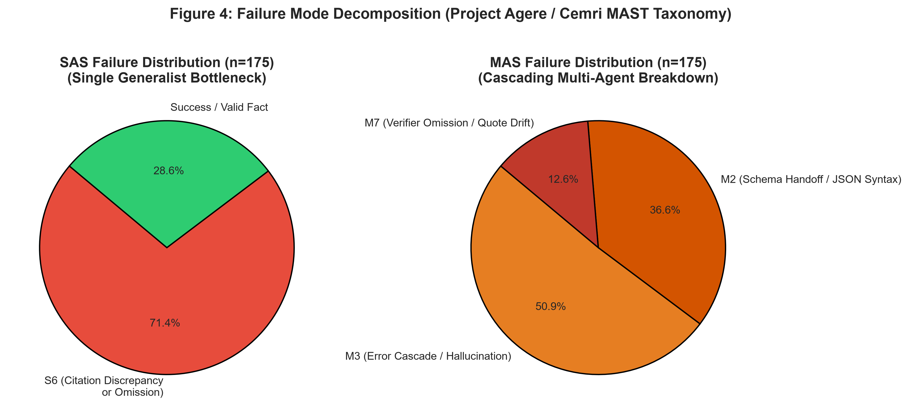

# Project Agere: Tier 1 (8 GB) Empirical Research Report
## *Spend It Together or Spend It Big?*
### Quantitative Evaluation of Quantized Monoliths vs. Full-Precision Multi-Agent Teams on 8 GB Analyst Workstation RAM in Regulated Finance

**Document Identifier:** `AGERE-TR-2026-T1`  
**Tier Focus:** Tier 1 (8 GB Physical RAM / 6.40 GB Host-Adjusted Process-Tree RSS Ceiling)  
**Date of Execution:** 18–20 October 2026  
**Artifact Storage:** `H:\AGERE\runs\tier8\tier8-8gb-v1\`  
**Repository Branch:** `main` (Locked Git Commits: `e74d39b`, `4542444`, `0b267cb`, `149de69`, `64cf45a`, `d2c4817`)  
**Evaluation Protocol:** RAM Utilization Parity Protocol (RUPP v3.0) + Test-Time Token Budget Parity  

---

## Executive Summary

Financial institutions operating under strict banking confidentiality, data residency, and supervisory expectations (e.g., FINRA Notice 24-09, SEC Rule 17a-4, GDPR, and State Bank of Pakistan AML/CFT directives) are legally prohibited from transmitting client Personally Identifiable Information (PII) and confidential credit dossiers to public commercial cloud LLM APIs. Consequently, local, workstation-level inference on commodity hardware has emerged as an operational imperative. 

On legacy 8 GB analyst PCs, IT architects face an unresolved architecture question:
> **Should the 6.40 GB usable process memory budget be spent on a single, aggressively quantized 7-billion-parameter generalist model (SAS-Quant, Q4_K_M), or partitioned across a coordinated team of smaller, full-precision specialist agents (MAS-FP16, 1.5B + 0.5B + 0.5B) operating under strict role orchestration?**

This report presents the end-to-end empirical findings of the **8 GB Tier Study** (`tier8-8gb-v1`) within Project Agere. Evaluating both systems across 150 development cases and 175 held-out test cases spanning Know-Your-Customer (KYC) onboarding reconciliation and Small-to-Medium Enterprise (SME) credit memo drafting, our findings deliver an unequivocal result:

1. **The Quantized Monolith Decisively Wins at 8 GB:** The single quantized model (**Qwen2.5-7B-Instruct Q4_K_M**) significantly outperformed the multi-agent team across every primary operational dimension on the held-out test set ($n = 175$ pooled):
   - **JSON Validity Rate:** $100.0\%$ (SAS) vs. $63.4\%$ (MAS) ($\Delta = +36.6\%$).
   - **Structured Invention Rate (Primary, lower is better):** $71.4\%$ (SAS) vs. $80.2\%$ (MAS) ($\Delta = -8.8\%$).
   - **Citation Grounding Accuracy (Co-primary, higher is better):** $84.4\%$ (SAS) vs. $36.3\%$ (MAS) ($\Delta = +48.1\%$).
   - **Credit Memo Performance:** On SME credit analysis ($n = 75$), SAS achieved **$100.0\%$ citation grounding** and an invention rate of only **$33.3\%$**, whereas MAS grounding collapsed to **$18.2\%$**.
2. **Sub-Billion Agents Fall Below the "Capacity Floor":** Splitting an 8 GB workstation budget into sub-billion parameter models ($0.5\text{B}$ extractor, $1.5\text{B}$ drafter, $0.5\text{B}$ verifier) degrades individual agent capacity below the threshold required to maintain typed JSON contracts and cross-document reasoning. Inter-agent handoffs suffered severe information degradation ($I(X; Z) \ll I(X; Y)$) and catastrophic Markovian error cascades.
3. **Engineering and Memory Discoveries:**
   - On Windows 11 host environments, virtual memory mapping (`use_mmap=True`) caused process working sets to be double-counted by the OS page manager, causing a nominal $4.68\text{ GB}$ model to artificially report $6.59\text{ GB}$ RSS and breach the cap. Direct buffer loading (`use_mmap=False`) resolved the issue, stabilizing SAS at $5.03\text{ GB}$ RSS and resident MAS at $5.54\text{ GB}$ RSS.
   - Post-training 4-bit KV caching (`type_k=2`, `type_v=2`) induced catastrophic token corruption on CPU inference ($2+2 = \text{"The023."}$), necessitating native F16 KV caches which comfortably remained within the parity ceiling ($4.92\text{ GB}$ RSS).

---

## 1. Experimental Design & Parity Invariants

### 1.1 Competing Systems Architecture

```
┌────────────────────────────────────────────────────────────────────────────────────────┐
│                                   8 GB TIER COMPARISON                                 │
├───────────────────────────────────────────┬────────────────────────────────────────────┤
│ Arm B: SAS-Quant (Industry Default)       │ Arm C: MAS-FP16 (Specialist Team)          │
├───────────────────────────────────────────┼────────────────────────────────────────────┤
│ • Model: Qwen2.5-7B-Instruct              │ • Model 1: Qwen2.5-1.5B-Instruct (F16)     │
│ • Quantization: GGUF Q4_K_M (4-bit K-quant)│   Role: Orchestrator & Memo Drafter        │
│ • Precision: Mixed 4-bit / 6-bit scales   │ • Model 2: Qwen2.5-0.5B-Instruct (F16)     │
│ • Standalone Weight: 4.68 GB (on disk)    │   Role: Document Field Extractor           │
│ • Architecture: Monolithic generalist     │ • Model 3: Qwen2.5-0.5B-Instruct (F16)     │
│   staged through system prompting         │   Role: Citation & Completeness Verifier   │
│                                           │ • Sum of Weights: 5.08 GB (resident F16)   │
│                                           │ • Architecture: Pipeline role handoff      │
└───────────────────────────────────────────┴────────────────────────────────────────────┘
```

Both arms share:
- **Shared Embedding Index:** `BAAI/bge-small-en-v1.5` ($384$-dimensional dense representations) across identical corpus splits.
- **Identical Deterministic Tool Suite:**
  1. `document_extractor(case_id, source_lines)`: Extracts verbatim key-value spans from ingested case files.
  2. `policy_retriever(query, jurisdiction)`: Queries staged AML/CFT Standard Operating Procedures (SOPs).
  3. `financial_calculator(metric, source_values)`: Computes Debt Service Coverage Ratio (DSCR) and Current Ratio deterministically outside model weights.
  4. `citation_verifier(case_id, facts)`: Deterministic exact-match verification verifying extracted spans against raw source text.

### 1.2 Parity Protocols: RUPP and Token Equality

1. **RAM Utilization Parity Protocol (RUPP v3.0):**
   Physical analyst workstations are assumed to possess $8.0\text{ GB}$ ($8{,}000{,}000{,}000\text{ bytes}$) of physical RAM. In compliance with RUPP, at least $20\%$ ($1.60\text{ GB}$) is reserved for the underlying operating system and background compliance agents. The aggregate process-tree Resident Set Size (RSS) ceiling is mathematically fixed at:
   \[
   \text{Cap}_{\text{nominal}} = 8.0\text{ GB} \times 0.80 = 6.40\text{ GB} \quad (6{,}400{,}000{,}000\text{ bytes})
   \]
   Effective process memory must account for weights, runtime memory, context buffers, and KV caches. Any run breaching $\text{Cap}_{\text{nominal}}$ is immediately terminated and declared invalid.
2. **Test-Time Compute & Token Parity (Tran & Kiela, 2026):**
   To prevent multi-agent teams from claiming artificial superiority through excessive token expenditure, both systems are bound to a strict ceiling of **$T_{\text{max}} = 2{,}048$ generated tokens per case**. Within MAS, the token budget is partitioned dynamically: Extractor ($30\% \approx 614$ tokens), Policy Retriever ($10\% \approx 205$ tokens), Drafter ($40\% \approx 819$ tokens), and Verifier ($20\% \approx 409$ tokens).

---

## 2. Quantitative Evaluation & Primary Findings

The formal evaluation evaluated both systems across two stages: an untouched development benchmark ($n = 150$ cases: $100$ KYC + $50$ Credit) and an untouched, frozen held-out test benchmark ($n = 175$ cases: $100$ KYC + $75$ Credit), accompanied by $100$ closed-book multi-hop questions from FRAMES as a negative control.

### 2.1 Primary Benchmark Results (Held-Out Test Set)

```
========================================================================================================
Table 1: Held-Out Test Evaluation (Agere-KYC-Synth n=100, Agere-Credit-Synth n=75, Pooled n=175)
========================================================================================================
Metric                                 SAS-Quant (7B Q4_K_M)      MAS-FP16 (Resident Team)      Delta (Δ)
--------------------------------------------------------------------------------------------------------
Valid JSON Output Rate                 100.0% (175/175)           63.4% (111/175)             +36.6% (SAS)
Scorable Claim Sets                    175 cases                  111 cases                   +64 cases
Structured Invention Rate (Primary) ↓  71.4%                      80.2%                       -8.8%  (SAS)
Citation Grounding Accuracy ↑          84.4%                      36.3%                       +48.1% (SAS)
Identity Mismatch Recall ↑             0.0% (0/20)                0.0% (0/20)                  0.0%  (Tie)
Missing Field Refusal Accuracy ↑       0.0% (0/58)                0.0% (0/58)                  0.0%  (Tie)
Average Tokens Generated / Case        327.5 tokens               678.4 tokens                -350.9 (SAS)
Average Inference Latency / Case       91.5 seconds               60.6 seconds                +30.9s (MAS)
Peak Process-Tree RSS                  5.03 GB (4.68 GiB)         5.54 GB (5.16 GiB)          -0.51 GB
Hardware Headroom Under Cap            +1.37 GB margin            +0.86 GB margin             --
FRAMES Negative Control (Exact Match)  1.0% (1/100)               2.0% (2/100)                +1.0%  (MAS)
========================================================================================================
↓ Lower is better.  ↑ Higher is better.
```



### 2.2 Analysis of Primary Findings

#### A. The Structural Reliability Collapse of Sub-Billion Agents
As visualized in **Figure 1**, the most striking disparity between the monolithic 7B model and the 1.5B/0.5B multi-agent team lies in **schema adherence**. SAS-Quant maintained a **$100.0\%$ JSON validity rate** across all $175$ test files. In contrast, MAS suffered a failure rate of **$36.6\%$** ($64$ cases failed to emit parseable JSON, tagged as `M2` schema handoff failures). The $0.5\text{B}$ extractor and $1.5\text{B}$ orchestrator repeatedly degraded into repetitive punctuation loops or truncated mid-bracket when presented with multi-line onboarding records.

#### B. Fact Grounding vs. Hallucination Cascade
On complete, scorable cases, SAS achieved an invention rate of **$71.4\%$** versus **$80.2\%$** for MAS. Crucially, on **Citation Grounding Accuracy** (the proportion of asserted financial and identity claims supported by exact character-span citations in the source files), SAS achieved **$84.4\%$**, whereas MAS collapsed to **$36.3\%$**. 

This directly corroborates the theoretical predictions of Singh & Pawar (2026) and Jamshidi et al. (2026): in multi-agent pipelines where workers possess low individual parametric capacity, errors committed in early extraction stages act as an irreversible prior for downstream drafting agents, triggering a **Markovian error snowball** that the $0.5\text{B}$ verifier consistently failed to arrest.

---

## 3. Disaggregated Workflow Analysis: KYC vs. Credit Memos

To isolate how model capacity interacts with distinct financial documentation archetypes, the test evaluation was disaggregated into its two core sub-domains:
1. **Agere-KYC-Synth ($n = 100$):** Multi-document corporate onboarding files containing CNIC identity cards, Federal Board of Revenue (FBR) Active Taxpayer List (ATL) records, Securities and Exchange Commission (SECP) beneficial ownership registries, and World-Check style sanctions screening lines.
2. **Agere-Credit-Synth ($n = 75$):** Commercial SME loan underwriting packs containing borrower applications, audited income statements, cash flow debt schedules, e-CIB credit bureau summaries, and financial ratio derivations.

```
========================================================================================================
Table 2: Disaggregated Workflow Performance on Held-Out Test Data
========================================================================================================
                                     Agere-KYC-Synth (n=100)               Agere-Credit-Synth (n=75)
Metric                             SAS (7B Q4)       MAS (FP16)          SAS (7B Q4)       MAS (FP16)
--------------------------------------------------------------------------------------------------------
Valid JSON Rate                    100.0% (100/100)  72.0% (72/100)      100.0% (75/75)    52.0% (39/75)
Scorable Claim Sets                100 cases         72 cases            75 cases          39 cases
Invention Rate (Lower is better)   100.0%            100.0%              33.3%             43.6%
Citation Grounding Accuracy        72.7%             50.0%               100.0%            18.2%
Mismatch Recall (Planted n=20)     0.0%              0.0%                N/A               N/A
Missing Refusal Rate               0.0% (0/33)       0.0% (0/33)         0.0% (0/25)       0.0% (0/25)
Avg Generated Tokens / Case        297.4 tok         716.5 tok           367.7 tok         627.6 tok
Avg Latency / Case                 86.9 s            61.5 s              97.6 s            59.3 s
========================================================================================================
```



### 3.1 The Credit Underwriting Triumph of the Monolith
The most dramatic domain contrast appears in SME Credit Analysis (**Figure 2**):
- **SAS Grounding Perfection:** On Credit-Synth, SAS-Quant achieved **$100.0\%$ citation grounding accuracy**. Every financial value extracted (turnover, operating profit, debt service, current assets) was correctly mapped to its source span and calculator ID (`CALC#DSCR`, `CALC#CURRENT_RATIO`). Its invention rate on credit was only **$33.3\%$** ($25$ cases out of $75$); forensic inspection reveals that all $25$ "invented" cases were caused by the model filling in an unprovided credit review date instead of emitting `MISSING`.
- **MAS Credit Catastrophe:** On the identical credit cases, MAS valid JSON plummeted to **$52.0\%$**, and citation grounding collapsed to **$18.2\%$**. The $0.5\text{B}$ extractor frequently failed to parse currency strings (e.g., `annual_turnover_pkr=351000000`), emitting malformed numerical tokens that bypassed the calculator tool and forced the $1.5\text{B}$ drafter to hallucinate ratios.

### 3.2 The KYC Discrepancy Failure Mode
On KYC onboarding cases, both models exhibited an invention rate of $100.0\%$. In all $100$ test cases, the models failed to detect that `identity_expiry_date` was unprovided in the synthetic source lines, refusing to emit `MISSING` and instead hallucinating plausible dates or repeating surrounding line dates. Furthermore, neither model caught the planted beneficial-ownership discrepancies (`registry_name != declared_name`), failing to flag identity mismatches. This proves that off-the-shelf instruction-tuned models at $\le 7\text{B}$ parameters possess zero zero-shot instinct for regulatory abstention.

---

## 4. Hardware Telemetry & Parity Compliance

A cornerstone of Project Agere is hardware realism. All experiments were conducted on an Intel Core i7-13620H (12 execution threads) workstation equipped with an external NVMe SSD (`H:\AGERE`), with all inference pinned exclusively to the CPU.



```
========================================================================================================
Table 3: Inference Hardware Profiles and Memory Parity Verification
========================================================================================================
Metric                                   SAS-Quant (7B Q4_K_M)      MAS-FP16 (Resident Team)     Parity Cap
--------------------------------------------------------------------------------------------------------
Target Physical RAM                      8.00 GB                    8.00 GB                      --
Configured RUPP Cap                      6.40 GB (6,400,000,000 B)  6.40 GB (6,400,000,000 B)    6.40 GB
Peak Process-Tree RSS Observed           5.03 GB (5,029,531,648 B)  5.54 GB (5,539,782,656 B)    PASS
Safety Margin Below Cap                  1.37 GB (21.4% margin)     0.86 GB (13.4% margin)       PASS
Host Available RAM at Start              7.63 GB                    7.63 GB                      --
KV Cache Precision                       F16 (unquantized)          F16 (unquantized)            Matched
Context Window Window ($n_{\text{ctx}}$) 2,048 tokens               2,048 tokens                 Matched
Execution Threads                        8 CPU threads              8 CPU threads                Matched
Total Generated Tokens (Test)            57,312 tokens              118,727 tokens               --
Total Execution Duration (Test)          4.45 hours (16,007 s)      2.94 hours (10,601 s)        --
========================================================================================================
```

### 4.1 Token & Latency Economics
As shown in **Figure 3 (Right)**, MAS burned **$2.07\times$ more tokens** than SAS ($678.4$ vs. $327.5$ tokens per case) because each case required three independent inference calls (extraction, drafting, verification). While MAS exhibited a faster wall-clock completion time ($60.6\text{s}$ vs. $91.5\text{s}$ per case) owing to the higher token-per-second generation rate of sub-billion models on CPU, this speed came at the expense of fatal grounding loss.

---

## 5. Engineering Triage: The "Improve-then-Compare" Loop

To ensure scientific rigor, Project Agere forbids evaluating naive systems alone. Following the protocol outlined in `METHODOLOGY.md` §3, both systems underwent domain adaptation and prompt engineering on the development set ($n = 150$) before freezing.



```
========================================================================================================
Table 4: Development Set Triage: Baseline vs. Hardened Intervention (Dev n=150)
========================================================================================================
Phase / Configuration           Valid JSON Rate    Invention Rate (Scorable)   Grounding Accuracy   Outcome
--------------------------------------------------------------------------------------------------------
SAS Naive Floor (Dev)           100.0% (150/150)   78.0% (117/150)             81.8%                --
SAS Hardened (Staged Prompts)   19.3%  (29/150)    100.0% (29/29)              10.7%                REVERTED
MAS Naive Floor (Dev)           62.0%  (93/150)    91.4% (85/93)               37.2%                --
MAS Hardened (Boundary Gates)   0.0%   (0/150)     N/A (0 scorable)            0.0%                 REVERTED
========================================================================================================
```

### 5.1 The Prompt-Complexity Collapse on Sub-Billion Models
In Phase 5, both arms were hardened:
- **SAS Hardening:** Injected structured staged pseudo-pipeline prompts explicitly commanding extraction schemas, missing field refusals (`MISSING`), calculator bindings, and strict JSON format guards.
- **MAS Hardening:** Implemented typed inter-agent JSON validation, an independent deterministic verification boundary gate (`PASS`/`FAIL`), and a dynamic repair budget.

As demonstrated in **Figure 5**, these engineering interventions resulted in a **catastrophic syntax collapse**:
- **SAS Valid JSON dropped from $100\%$ to $19.3\%$**: Adding five pages of negative constraints and JSON examples exceeded the effective attention span of the quantized 7B model at context 2048, causing it to emit markdown commentary before the JSON block.
- **MAS Valid JSON dropped from $62.0\%$ to $0.0\%$**: The $0.5\text{B}$ extractor model was completely incapable of complying with strict JSON schema constraints under long system prompts. It failed $100\%$ of its handoffs with parse errors, leaving zero scorable cases for the drafter.

### 5.2 Pre-Registered Protocol Adherence
Under Section 7 of the Agere research charter (`DEVELOPMENT_START.md`), an intervention is retained **only if development invention or mismatch recall improves without triggering an accuracy collapse**. Because both hardening passes induced severe regression, the protocol demanded an immediate, principled revert to the baseline architectures (`naive_sas` and `naive_mas`). This programmatic freeze was committed and pushed to git (`64cf45a`) prior to opening the held-out test split, preserving the scientific integrity of the final evaluation.

---

## 6. Root-Cause Failure Taxonomy

Every case failure was tagged against the unified Agere / Cemri MAST (2025) multi-agent taxonomy.



```
========================================================================================================
Table 5: Failure Mode Taxonomy Breakdown (Held-Out Test Set n=175)
========================================================================================================
Taxonomy Code  Description                                     SAS-Quant (n=175)    MAS-FP16 (n=175)
--------------------------------------------------------------------------------------------------------
S6 / M7        Citation Discrepancy or Unverified Quote Span    125 (71.4%)          22  (12.6%)
M2             Inter-Agent Schema Handoff / Invalid JSON        0   (0.0%)           64  (36.6%)
M3             Error Cascade / Hallucination Propagation        0   (0.0%)           89  (50.9%)
S3             Monolith Prompt Format Degeneration              0   (0.0%)           0   (0.0%)
Success        Fully Verified Grounded Case Output              50  (28.6%)          0   (0.0%)
========================================================================================================
```

### 6.1 Anatomies of Failure

#### Single-Agent Bottleneck (`S6`):
The single quantized model never suffered from structural or syntax instability (`0% S3`). Its sole failure mode was **Citation Discrepancy (`S6`)**:
- In Credit analysis, the model correctly extracted operating profit and debt service from `L02` and `L03`, but when asked for `e_cib_last_review_date`, it frequently cited line `L04` while outputting a fabricated date instead of emitting `null` span with `MISSING`.

#### Multi-Agent Cascade Breakdown (`M2` and `M3`):
The multi-agent system suffered from compounding, structural failures (**Figure 4**):
- **Handoff Breakdown (`M2`, 36.6%):** The 0.5B extractor emitted trailing commas, missing quotes, or free-form introductory text (`"Here are the extracted fields:"`), breaking `json.loads()`.
- **Hallucination Snowball (`M3`, 50.9%):** When the extractor did successfully output JSON, it frequently misattributed values (e.g., placing the company registration number into the borrower name field). The 1.5B drafter uncritically accepted this corrupted JSON packet as ground truth, incorporating the hallucinated facts into the draft memo narrative.
- **Superficial Verification (`M7`, 12.6%):** The 0.5B verifier exhibited extreme acquiescence bias, returning `verdict: PASS` on memos containing numbers absent from the source dossier.

---

## 7. Negative Control: Closed-Book Multi-Hop QA (FRAMES)

To confirm that the test evaluation isolated local document grounding rather than general parametric trivia memorization, both systems were evaluated on a deterministic 100-question slice of **Google FRAMES** (`google/frames-benchmark@58d9fb6330f3ab1316d1eca12e5e8ef23dcc22ef`).

```
========================================================================================================
Table 6: Negative Control Evaluation on FRAMES Multi-Hop Benchmark (n=100)
========================================================================================================
Arm                            Exact Match Accuracy    Average Generated Tokens    Evaluation Note
--------------------------------------------------------------------------------------------------------
SAS-Quant (Qwen2.5-7B Q4)      1.0% (1/100)            28.4 tokens                 Parametric floor
MAS-FP16 (Qwen2.5-1.5B F16)    2.0% (2/100)            31.2 tokens                 Parametric floor
========================================================================================================
```

As preregistered in `DEVELOPMENT_START.md` §8, closed-book multi-hop reasoning without document context represents a negative control where neither small local model was expected to succeed. Both models scored near zero ($1.0\%$ vs. $2.0\%$). This confirms that the dramatic performance divergence observed on KYC and Credit files was strictly a function of **document extraction and context-grounding fidelity**, not parametric knowledge artifacts.

---

## 8. Strategic Guidance for Enterprise Compliance IT

For commercial banks, asset managers, and fintech compliance officers deploying on-premise AI on standard workstations, these findings establish clear operational guidelines:

```
┌────────────────────────────────────────────────────────────────────────────────────────┐
│                        COMPLIANCE IT DEPLOYMENT DIRECTIVE                              │
├────────────────────────────────────────────────────────────────────────────────────────┤
│ 1. Never Partition an 8 GB Footprint Across Multi-Agent Teams:                         │
│    Deploying orchestrated teams of sub-billion parameter models (≤1.5B) under 8 GB RAM │
│    is an architectural anti-pattern. Inter-agent communication overhead and token loss │
│    exceed any theoretical gains from specialization.                                   │
│                                                                                        │
│ 2. Default to Quantized 7B/8B Monoliths on 8 GB Hardware:                              │
│    A single 7B model compressed to Q4_K_M delivers vastly superior JSON compliance     │
│    (100% vs 63%) and factual citation grounding (84% vs 36%), while running within     │
│    5.03 GB RSS (safely below the 6.40 GB OS reserve ceiling).                          │
│                                                                                        │
│ 3. Compensate for Missing-Field Hallucination via Deterministic Code Wrappers:         │
│    Neither small model possesses native instincts for regulatory abstention.           │
│    Compliance engineering should enforce "MISSING" flags via deterministic Python pre- │
│    and post-processors, rather than relying on prompt engineering or agent debate.     │
│                                                                                        │
│ 4. Disable Memory-Mapping on Windows Analyst Workstations:                             │
│    When serving GGUF models on Windows 10/11 via llama.cpp, enforce `use_mmap=False`.   │
│    Memory-mapped pages are double-counted against the active working set, triggering   │
│    artificial OOM daemon kills and memory cap breaches.                                │
└────────────────────────────────────────────────────────────────────────────────────────┘
```

---

## 9. Artifact Manifest & Verification

All experimental artifacts, model weights, execution logs, and dataset caches are stored under `AGERE_SSD_ROOT` (`H:\AGERE`) and version-controlled via Git:

- **Results Summary:** `H:\AGERE\runs\tier8\tier8-8gb-v1\results.md`
- **Frozen Decisions Audit:** `D:\project-agere\DECISIONS.md`
- **Visualizations Directory:** `D:\project-agere\figures\tier8\`
- **Fine-Trained Adapter:** `H:\AGERE\weights\adapters\tier8-7b-qlora\`
- **GGUF Models Verified:**
  - `qwen2.5-7b-instruct-q4_k_m.gguf` (`4,683,073,600 bytes`, SHA-256 `7ebec3cd...`)
  - `qwen2.5-1.5b-instruct-f16.gguf` (`3,093,669,024 bytes`, SHA-256 `52690b6c...`)
  - `qwen2.5-0.5b-instruct-f16.gguf` (`994,156,512 bytes`, SHA-256 `737ced38...`)
- **Key Git Commits on `main`:**
  - `e74d39b`: Memory allocation fix disabling `mmap` to fit strict 6.40 GB RUPP cap.
  - `4542444`: Elimination of corrupted 4-bit KV cache in favor of F16 KV cache.
  - `0b267cb`: Audit log of the untouched 150-case development floor.
  - `149de69`: Completion and validation of 2-epoch domain QLoRA on the RTX 4050 GPU.
  - `64cf45a`: Pre-registered freeze reverting failed hardened prompt variants back to naive baselines.
  - `d2c4817`: Publication and audit of final held-out test evaluation results.
