# Advanced statistical evaluation: deployments at or below16 GB

## Integrated empirical evidence, uncertainty and conditional theoretical framework

**Date:**30 October2026. **Status:** pre-paper statistical dossier. No32 GB outcomes are available.
**Primary16 GB sample:**160 questions /50 reports /36 companies;960 repeated outputs.
**Historical matched numerical cohorts:**101 questions /30 reports;768 repeated outputs. Additional development/probe cohorts are listed separately.
**Legacy synthetic test:**175 cases, evaluated by two arms; metrics are not pooled with FinQA.

## 1. Executive inferential conclusion

The primary reported-answer contrast is MAS minus SAS: -73 correct deliveries (-45.625 percentage points), -45 wrong deliveries (-28.125 points), and +118 withholdings (+73.75 points). Raw execution gives -33 correct, -85 wrong, and the same +118 withholdings. Both metrics therefore show a correctness-versus-withholding trade-off, not MAS Pareto superiority.

Conditional precision among delivered primary answers is 61.90% for SAS (78/126) and 62.50% for MAS (5/8) under reported scoring. Similar conditional precision conceals radically different coverage: 78.75% versus 5.00%. Under raw execution precision is30.16% for SAS and 62.50% for MAS, again over different selected delivery sets. A small selected denominator is not evidence that MAS solves most questions more reliably.

This synthesis is sufficient to organize a bounded empirical manuscript, but not to claim a universally superior architecture or a novel inference method. Both numeric metrics, the withholding reference, source cohorts and historical resource failures remain mandatory parts of interpretation. Formal propositions are conditional definitions/bounds rather than proofs that observed model rankings generalize.

## 2. Study ledger, denominators and comparability

| Dimension | Historical8 GB | Redeveloped8 GB FinQA | 16 GB FinQA |
| --- | --- | --- | --- |
| Task | Synthetic KYC/credit | Public train-source numerical QA | Public dev-source numerical QA |
| Unique questions | 175 test cases | 52 selection +49 reserved | 160 questions |
| Primary unit | Synthetic case/template | 15+15 company-year reports | 50 reports /36 companies |
| SAS | 7B Q4 | 7B Q4 + trained adapter | 14B Q4 pretrained |
| MAS | 1.5B+.5B+.5B F16 | Shared 3B Q4 role backbone + adapters | 1.5B+3B+.5B distinct F16 |
| Context | 2048 | 4096 | 4096 |
| Memory ceiling | 6.4GB | 6.4GB | 11.5 GB |
| Adaptation | Final naive baseline | Extensive development/adaptation | Pretrained both arms |
| Serving/backend | Earlier Windows study | Earlier native CPU backend | Portable AVX2 CPU backend |
| Causal RAM scaling comparison | No | No | No; recipes/question source differ |

The natural8 GB development inventory covers15 completed configurations,768 generated case outputs on 101 unique questions from 30 reports. The 16 GB study adds960 outputs on 160 unique questions from 50 different reports. The ID/report intersection is empty. These are1728 FinQA outputs but261 unique questions, with substantial repeated-condition dependence within each study. Adding historical synthetic paired outputs gives2078 core-ledger outputs on 436 distinct tasks/questions across unlike task regimes; that is NOT a valid pooled statistical N. Additional development, fitting, probe and external-control diagnostics are separate and are not counted as independent replications in that core ledger.

Within the 8 GB model-selection set, matched control SAS reports8/23/21 and control MAS 3/19/30; crossed SAS 10/16/26 and crossed MAS 3/15/34. On reserved49 questions, control SAS 8/20/21 versus MAS 4/17/28, and crossed SAS 9/20/20 versus MAS 4/9/36. The reported-correct ordering favors SAS in these observed pairs, but the magnitude cannot be read as a RAM effect or as independent replications across all variants.

The final reasoned8 GB secondary runs are also complete: original SAS 9/24/19, control9/20/23 and crossed9/10/33. Crossed preserves reported-correct deliveries while withholding more wrong answers; against control, raw correct falls11 to 10. The paired adoption gate across both metrics therefore still fails. The older8 GB statistical PDF predates these completed results and must not be treated as the final chronology.

The original8 GB empirical report used stronger language about legal necessity, universal capacity floors, Markov error cascades and causal mechanisms. Those claims are not carried forward as established facts. The raw synthetic summaries are rechecked here, while their unlike denominators/tasks and the absence of a factorial architecture experiment remain explicit. The 8 GB statistical PDF also relied on case-wise or unpaired tests in places; this dossier favors actual pairs and report/company dependence where data support it.

## 3. Historical synthetic results and their measurement limits

| Historical synthetic test | SAS | MAS | Qualification |
| --- | --- | --- | --- |
| Valid JSON | 175/175 | 111/175 | Different from FinQA numerical correctness |
| Complete claim-set invention | 125/175 | 89/111 | MAS denominator excludes64 malformed outputs |
| Citation grounding | 84.40% | 36.35% | Claim-level metric; not answer accuracy |
| Mismatch recall | 0/20 | 0/20 | Planted synthetic positives; not population equivalence |
| Peak RSS GB | 5.030 | 5.540 | Nominal8 GB resource setting; not physical8 GB validation here |

The invention metric is conditional on complete claim sets and the grounding metric is claim-level. A union denominator175 cannot be substituted into89/111 without redefining the metric; malformed outputs must remain visible separately. The old report's claim that its negative-control results prove a specific grounding mechanism is not established by those marginal outcomes.

## 4. Complete8 GB numerical study ledger

| 8 GB condition | N | Reported C / W / H | Raw C / W / H | Peak GB |
| --- | --- | --- | --- | --- |
| Reserved: control mas | 49 | 4 / 17 / 28 | 8 / 13 / 28 | 5.052 |
| Reserved: control sas | 49 | 8 / 20 / 21 | 14 / 14 / 21 | 5.368 |
| Reserved: crossed mas | 49 | 4 / 9 / 36 | 7 / 6 / 36 | 5.064 |
| Reserved: crossed sas | 49 | 9 / 20 / 20 | 15 / 14 / 20 | 5.364 |
| Selection: baseline mas | 52 | 2 / 19 / 31 | 3 / 18 / 31 | 5.058 |
| Selection: baseline original classic mas | 52 | 4 / 18 / 30 | 6 / 16 / 30 | 5.046 |
| Selection: baseline original critic common actor | 52 | 4 / 22 / 26 | 6 / 20 / 26 | 5.056 |
| Selection: baseline sas-analysis128-demos2 | 52 | 9 / 24 / 19 | 10 / 23 / 19 | 5.368 |
| Selection: baseline sas | 52 | 8 / 25 / 19 | 10 / 23 / 19 | 5.348 |
| Selection: control mas | 52 | 3 / 19 / 30 | 5 / 17 / 30 | 5.060 |
| Selection: control sas-analysis128-demos2 | 52 | 9 / 20 / 23 | 11 / 18 / 23 | 5.365 |
| Selection: control sas | 52 | 8 / 23 / 21 | 10 / 21 / 21 | 5.356 |
| Selection: crossed mas | 52 | 3 / 15 / 34 | 5 / 13 / 34 | 5.067 |
| Selection: crossed sas-analysis128-demos2 | 52 | 9 / 10 / 33 | 10 / 9 / 33 | 5.370 |
| Selection: crossed sas | 52 | 10 / 16 / 26 | 12 / 14 / 26 | 5.368 |

### Supporting diagnostics remain separate

| Supporting study | Cohort | Observed result | Interpretation limit |
| --- | --- | --- | --- |
| 3B actor adaptation | 24 development | +11 correct candidates; delivered0/0/24 to 10/11/3 | Known QLoRA baseline improvement; not11 delivered correct |
| Trained 3B critic | 24 natural /23 reports | C 3 to 11; W 0 to 4 | Same11 correct candidates; coverage/error trade-off |
| Shared 3B role serving | 2 prompts /4 switches | RSS 4.831 to 2.571 GB; observed logit delta0 | Small equivalence probe, not full-QA equivalence or novelty |
| Header / catalog fitting | 73 fitting cases | Mappable41 to 45; same 4 recovered cases | No neural QA-gain measurement; excluded16 GB |
| MortarBench | 90 questions /9 groups | SAS 39 vs MAS 26 exact | Different workflow/metric; no pooled FinQA score |
| Later FRAMES control | 100 questions | SAS 2 vs MAS 1 exact | Near-floor control; not causal proof of failure mechanism |

The 3B actor-adaptation comparison gained11 correct candidates but delivered10 correct answers; candidate correctness is not delivery. Header/catalog mapping41 to 45 of 73 and all 183 newly exposed catalog occurrences being already visible are representation diagnostics, not measured QA improvements. The early synthetic FRAMES result(SAS 1, MAS 2 of 100) and later result(SAS 2, MAS 1) are separate baseline/control settings, not a reliable monotonic trend. Controlled verifier/quartet probes and question-blind shortcut audits likewise do not establish natural QA ability.

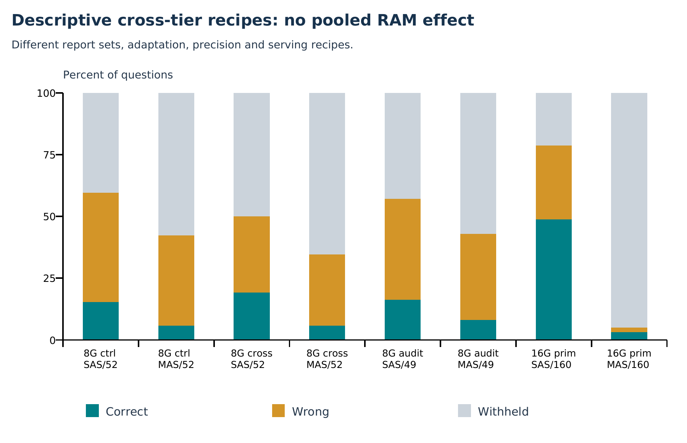

## 5.16 GB design and complete performance table

The experiment compares complete deployment recipes on the same questions, not isolated architecture, precision or parameter-count factors. SAS uses pretrained Qwen2.5-14B-Instruct Q4_K_M. Resident MAS uses pretrained Qwen2.5-1.5B-Instruct F16 for extraction/source suggestion, 3B F16 for drafting, and 0.5B F16 for verification. All declared MAS model instances stay loaded; there is no role-backbone sharing. Both arms are pretrained: the 8 GB trained adapters are not compatible with the larger SAS checkpoint and are not reused.

Both arms use CPU inference, eight threads, greedy decoding, seed 42, context 4,096 per call, `use_mmap=False`, no GPU layers, the same public evidence packets, and a 2,048 generated-token ceiling per case across stages. Equal ceilings do not mean equal expenditure or equal FLOPs. Prompt-token totals sum all calls and may exceed a single context window. The public packet uses lexical top-eight source-unit retrieval; MAS has the existing source-suggestion stage. Internal prompts/call counts therefore differ.

The primary profile uses the existing 128-token analysis allowance and two fixed training demonstrations, binary review, and no repair. Direct-control removes both analysis and demonstrations. Repair-ablation keeps primary prompting and adds the existing repair/review policy. These are bundled profile contrasts; they do not isolate demonstrations from analysis. No new source catalog, header materialization, adaptive repair method, training or routing was adopted for this evaluation.

All 50 reports were selected by fixed ID hash, excluding recorded earlier development/report exposure; all questions in a chosen report were retained. Scoring annotations were kept separate from sealed public packets. These are public FinQA development-source reports, not the official test split, bank client files, or a guarantee against model pretraining contamination. All output cases remain in denominators, including insufficient answers and withheld outputs.

For each numerical metric, C means a correct delivered answer, W a wrong delivered answer, and H a withheld answer. Candidate correctness is not delivery: a correct candidate can be withheld. Coverage is (C+W)/N; conditional precision is C/(C+W). A system that withholds everything has zero wrong deliveries and zero useful answers.

The reported-answer metric uses the existing declared-unit normalization and rounding tolerance against `qa.answer`. The raw-execution metric uses the existing relative/absolute tolerance against `qa.exe_ans`, without reported-answer normalization. Neither is an official FinQA program-equivalence implementation. They assess related but different numerical conventions; neither is chosen after seeing which favors an arm. Source-supported execution means the deterministic operand/program checks passed, not that the final answer is financially correct.

| Profile / arm | Reported C / W / H | Raw C / W / H | Time (h) | Peak RSS (GB) |
| --- | --- | --- | --- | --- |
| primary / SAS | 78 / 48 / 34 | 38 / 88 / 34 | 11.546 | 10.062 |
| primary / MAS | 5 / 3 / 152 | 5 / 3 / 152 | 2.432 | 10.929 |
| direct control / SAS | 50 / 66 / 44 | 14 / 102 / 44 | 5.266 | 10.040 |
| direct control / MAS | 0 / 5 / 155 | 0 / 5 / 155 | 0.821 | 10.901 |
| repair ablation / SAS | 79 / 50 / 31 | 38 / 91 / 31 | 13.494 | 10.074 |
| repair ablation / MAS | 5 / 3 / 152 | 5 / 3 / 152 | 3.682 | 10.913 |

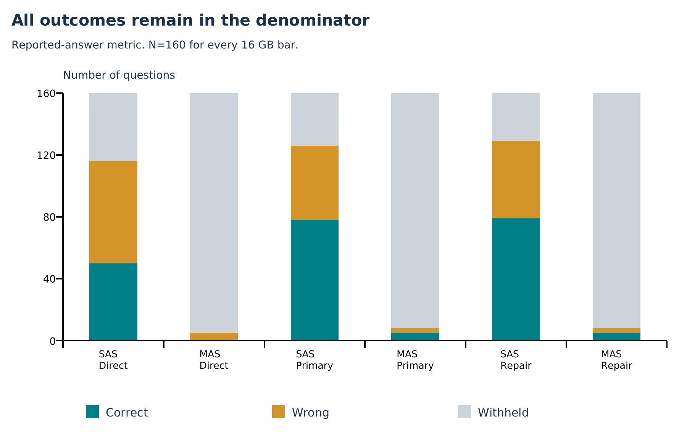

## 6. Primary estimates and dependent-data inference

| Endpoint | MAS-SAS (pp) | Report 95% CI (pp) | Company 95% CI (pp) | Holm p (4) |
| --- | --- | --- | --- | --- |
| Reported answer / correct | -45.62 | [-53.90, -36.55] | [-53.47, -36.44] | 0.000061 |
| Reported answer / wrong | -28.12 | [-37.09, -20.13] | [-38.36, -19.76] | 0.000061 |
| Reported answer / withheld | +73.75 | [+64.71, +81.93] | [+66.03, +81.10] | not independent test |
| Raw execution / correct | -20.62 | [-28.26, -13.37] | [-28.15, -14.07] | 0.000061 |
| Raw execution / wrong | -53.12 | [-61.90, -44.08] | [-61.99, -43.08] | 0.000061 |
| Raw execution / withheld | +73.75 | [+64.71, +81.93] | [+66.03, +81.10] | not independent test |

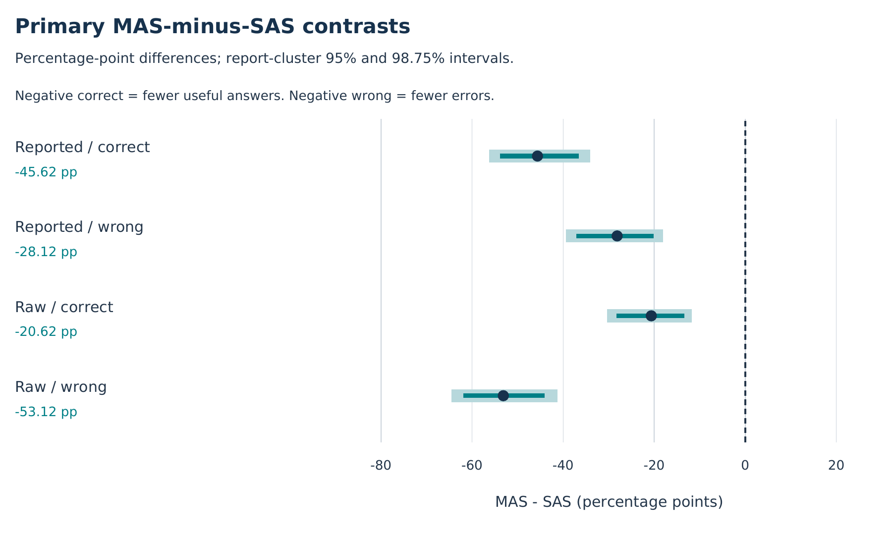

The prespecified primary comparison is the 16 GB primary-profile SAS/MAS pair. Endpoints were specified before evaluation; this extended statistical analysis, its extra tests and multiplicity grouping were written after inspecting results and are supplemental/post hoc. Secondary profiles and older experiments do not become additional chances to declare a favorable primary result.

Primary intervals resample all 50 company-year reports with replacement, retaining every question in each sampled report. The estimator remains question-weighted; sampled denominators vary with report sizes. We use 10,000 draws, NumPy `default_rng(42)`, and linear percentile quantiles. The original audit used Python `random.Random(42)` and different quantile indexing; its exact original JSON is retained. Small numerical interval differences are implementation differences, not different outcomes.

Company-level sensitivity resamples 36 companies, preserving their reports. We also report equal-report estimates and leave-one-report-out ranges. These checks address dependence/weighting sensitivity but cannot establish independence across firms or representative sampling. The ID-hash report selection is not a randomized architecture intervention.

Supplemental cluster sign-flip tests use independent cluster contributions and require sign-exchangeability/symmetry under the null. Nonzero cluster signs are enumerated exactly when at most 18 are present; otherwise 65,536 Monte Carlo sign assignments use seed 42 and p=(extreme+1)/(draws+1). These are not design-randomization causal p-values. At the Monte Carlo floor, p is not zero or infinitely precise. Case-IID exact McNemar results are included only as sensitivity diagnostics; they ignore report dependence.

Holm adjustment is applied to the four primary correct/wrong contrasts across the two metrics. Withholding is determined by the accounting identity and is not a fifth independent endpoint. Secondary tests are labelled exploratory/unadjusted. Bonferroni-style 98.75% bootstrap intervals are also provided for the four primary endpoints; their coverage remains approximate because bootstrap assumptions remain necessary.

Nonsignificance is not evidence of equality. No practical equivalence margin was prespecified, so no TOST/equivalence or noninferiority pass is declared. Zero-event bootstrap degeneracy is not population certainty. Precision comparisons condition on different selected delivery sets and are not interchangeable with matched unconditional accuracy comparisons. No post-hoc observed-power claim is used.

## 7. Cluster sensitivity and finite-sample limits

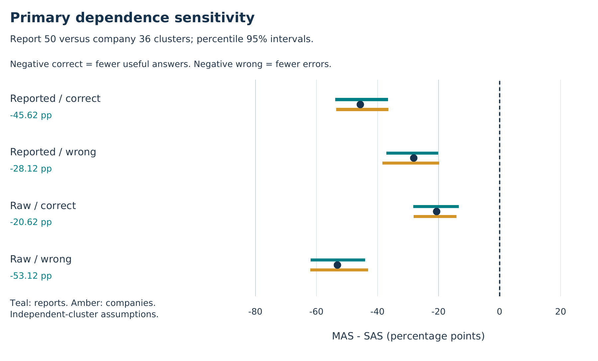

The bounded-cluster proposition below gives a deliberately conservative alternative to bootstrap precision. For the reported-correct primary contrast, the exported half-width is computed from the observed report-size weights. Broad bounds are a limitation of weak assumptions, not a reason to select a narrower test after seeing its significance. Effective cluster count is1/sum(w_g squared), which differs from the number of repeated outputs.

## 8. Paired transitions and candidate/gate decomposition

| Arm | Executable | Correct candidate | C delivered | W delivered | Correct withheld | Wrong withheld | Invalid withheld |
| --- | --- | --- | --- | --- | --- | --- | --- |
| SAS | 150 | 84 | 78 | 48 | 6 | 18 | 10 |
| MAS | 10 | 5 | 5 | 3 | 0 | 2 | 150 |

All 160 initial program-stage responses parse as JSON objects in both primary recipes. SAS emits150 ANSWER and 10 INSUFFICIENT decisions; MAS emits10 ANSWER and 150 INSUFFICIENT decisions. This is program-stage syntax, not the same whole-workflow metric as the older synthetic report. The known grammar constraint addresses format; it does not ensure useful semantic/program coverage.

Primary SAS produces150 executable candidates, of which84 are reported-correct; review delivers 78 correct and 48 wrong, withholding6 correct candidates and 18 executable wrong ones, in addition to 10 invalid/insufficient outputs. MAS produces10 executable candidates,5 correct; it delivers all 5 correct and 3 wrong, withholding2 wrong and 150 invalid/insufficient outputs. Its final low coverage is therefore not primarily a gate that rejects many correct drafts.

All annotated gold evidence is present in the public retrieval packet on 138/160 questions. Within that stratum SAS delivers 74 correct and has 3 invalid/insufficient outputs; MAS delivers 5 correct and has 128 invalid/insufficient outputs. Among 22 incomplete-retrieval questions, SAS delivers 4 correct and MAS 0. These are post-hoc reference-dependent diagnostics, not deployment routing features or causal evidence. Gold retrieval completeness does not certify reference-program expressibility in the compact catalog.

The analysis stage reaches its intentional128-token limit on 159 SAS and 157 MAS primary cases. These events must not be described as malformed final JSON or context failure: the audited structured generation continues afterward. The summaries record zero context/budget-skipped calls across these six jobs. A smaller context can still change reasoning quality, which this single-context study cannot estimate independently.

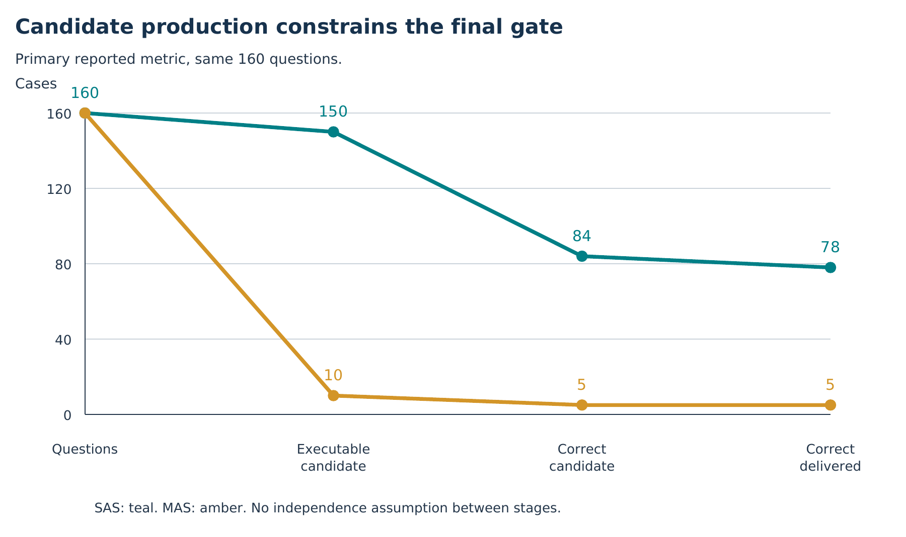

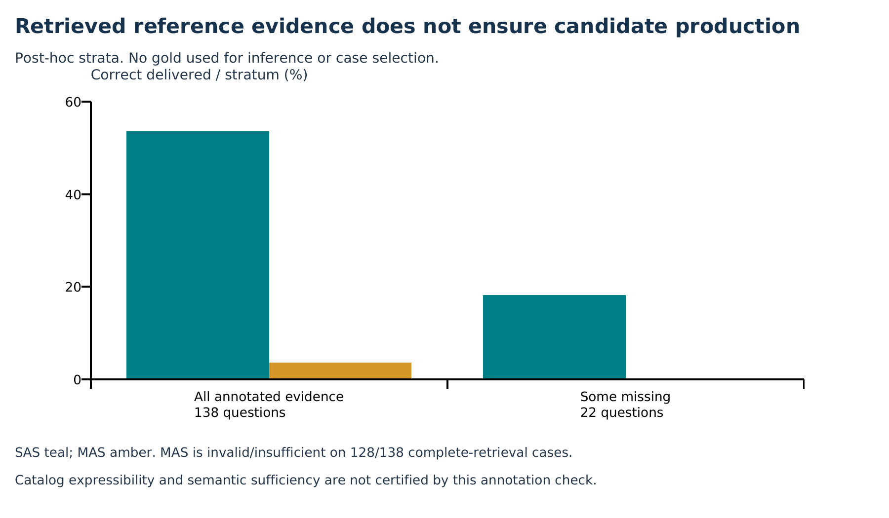

## 9. Repair and prompting as separate scientific questions

| Contrast (right-left) | Metric | Delta C | Delta W | C 95% CI (pp) | W 95% CI (pp) |
| --- | --- | --- | --- | --- | --- |
| sas-reasoned vs direct | Reported answer | 28 | -18 | [+9.76, +24.55] | [-17.98, -3.90] |
| sas-reasoned vs direct | Raw execution | 24 | -14 | [+8.59, +21.62] | [-17.96, +0.72] |
| mas-reasoned vs direct | Reported answer | 5 | -2 | [+0.00, +6.98] | [-5.26, +2.55] |
| mas-reasoned vs direct | Raw execution | 5 | -2 | [+0.00, +6.98] | [-5.26, +2.55] |
| sas-repair vs primary | Reported answer | 1 | 2 | [+0.00, +2.04] | [+0.00, +3.40] |
| sas-repair vs primary | Raw execution | 0 | 3 | [+0.00, +0.00] | [+0.00, +4.35] |
| mas-repair vs primary | Reported answer | 0 | 0 | [+0.00, +0.00] | [+0.00, +0.00] |
| mas-repair vs primary | Raw execution | 0 | 0 | [+0.00, +0.00] | [+0.00, +0.00] |

The reasoned profile changes both analysis allowance and demonstrations together. Relative to direct control, SAS gains28 reported correct deliveries and avoids18 wrong ones; raw execution gains24 correct and avoids14 wrong. MAS gains5 correct and avoids2 wrong under both metrics. These are actual matched profile contrasts, not proof that either component alone causes the change.

Primary and repair-ablation have identical initial answer, execution, score, verdict and plan on all 160 matched cases in both arms. SAS repair adds one reported-correct and two wrong deliveries by releasing previously withheld cases. Under raw execution it adds zero correct and three wrong deliveries. MAS attempts152 repairs yet every final delivery state remains identical to primary; source-supported candidate programs fall from 10 to 8 without a delivered-answer gain.

SAS repair adds about 1.95 inference hours; MAS adds about 1.25 hours. Extra compute is a measured cost, not a benefit or a novel mechanism. The no-repair primary was specified before this complete comparison; it was not selected afterward as the best-looking profile.

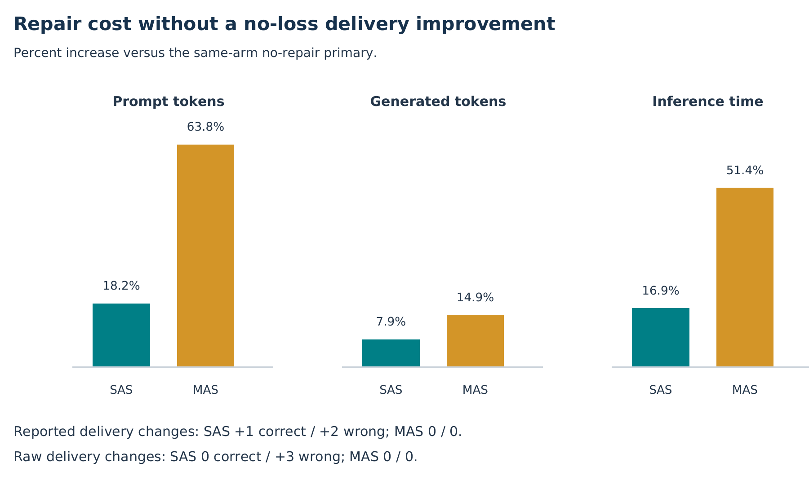

## 10. Metric sensitivity and annotation conventions

| Delivered SAS primary | Raw correct | Raw incorrect | Total |
| --- | --- | --- | --- |
| Reported correct | 34 | 44 | 78 |
| Reported incorrect | 4 | 44 | 48 |
| Total | 38 | 88 | 126 |

The primary SAS delivered-answer concordance has 34 correct under both metrics,44 reported-only correct,4 raw-only correct and 44 wrong under both. Thus48/126 deliveries change correctness label across metrics. Primary MAS has 5 correct under both and 3 wrong under both. The reported-versus-raw difference is not simply a subset relation.

For example, `AAPL/2005/page_83.pdf-1` yields26.6667 with declared unit number, matching the rounded reference answer26.7 but not raw `exe_ans=0.26667`. This illustrates source numerical-convention differences; it does not license relabelling all disagreements as model errors or all as annotation defects. All 48 disagreeing cases are exported in `metric_disagreements.csv`. Neither score is labelled official FinQA program equivalence.

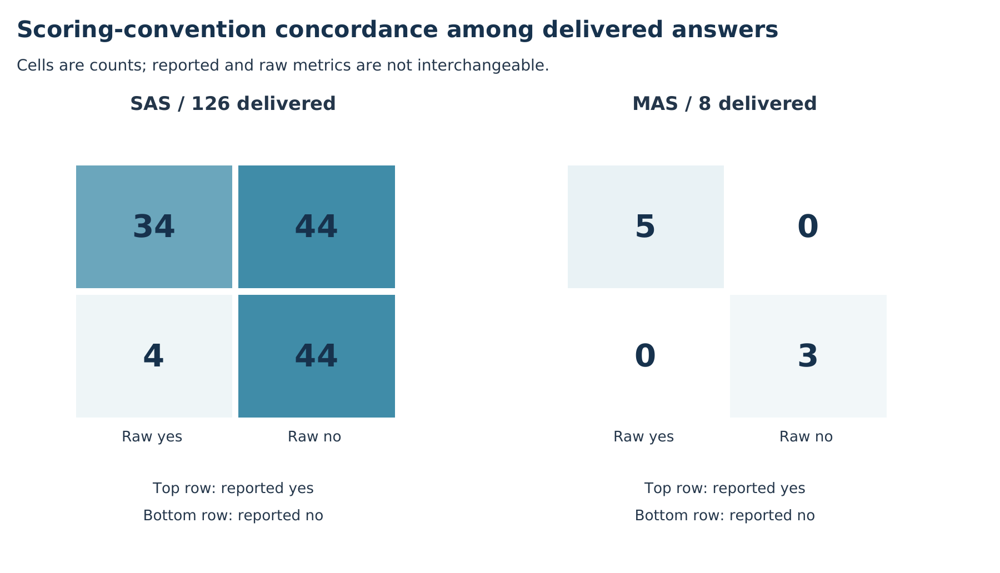

## 11. Risk, coverage and utility sensitivity

| Arm | Seconds/case | Seconds/reported correct | Generated/case | Prompt/case | Peak GB | Reported precision |
| --- | --- | --- | --- | --- | --- | --- |
| SAS | 259.78 | 532.88 | 204.11 | 4016.79 | 10.062 | 61.90% |
| MAS | 54.73 | 1751.38 | 184.43 | 4666.71 | 10.929 | 62.50% |

SAS uses more inference time per case, but its larger number of useful answers changes the economics. Primary MAS is about 4.75 times faster per case, yet requires roughly3.29 times as much inference time per reported-correct delivery. MAS also uses more primary peak RSS despite fewer nominal parameters:10.93GB versus 10.06GB. The observed memory ordering is compatible with precision/storage trade-offs, not a general theorem that one architecture always uses more memory.

Stage-inference seconds cover committed-case calls and exclude loading, waiting and uncheckpointed/retried work. Across all six jobs they sum to roughly37.24 hours. The last service alone ran a shorter wall-clock interval because it reused327 completed outputs; do not present that service duration as the entire experiment cost. Prompt tokens include repeated evidence across calls, and actual generated-token expenditure differs below the shared ceiling.

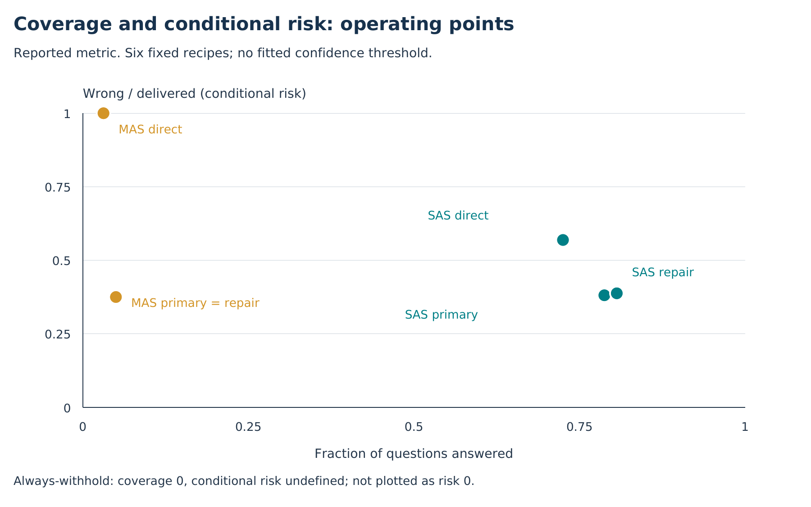

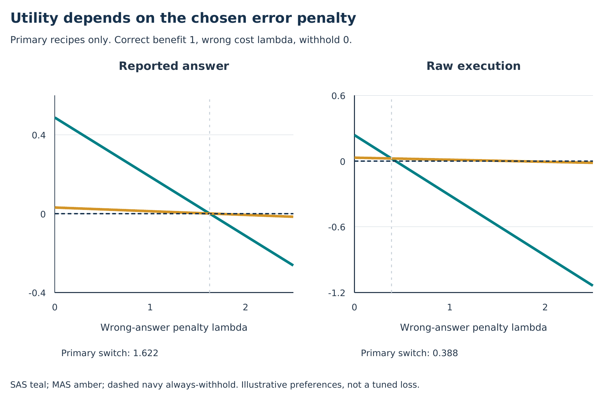

## 12. Formal definitions, proofs and their assumptions

### Scope of the mathematical statements

The following identities and bounds are elementary/established tools applied to the audit. They are not claimed as novel theorems. Each proposition states its assumptions; none proves an architecture universally better.

### Proposition 1: endpoint accounting and rejection confounding

For one fixed metric, every case has exactly one delivery state C, W or H.

```text
C + W + H = N
Delta(C/N) + Delta(W/N) + Delta(H/N) = 0
```

Proof: sum the mutually exclusive per-case indicator identities. Therefore fewer wrong deliveries can be achieved simply by withholding more; it is not by itself an improvement in useful correctness. Always-withhold has C=W=0 and H=N. This also explains why withholding is not an independent additional primary test.

### Proposition 2: fixed-candidate gating upper bound

Assume the review gate can accept/reject a fixed candidate but cannot change its answer. Let A be the set of valid correct candidates and D the delivered set.

```text
C_gate = |A intersect D| <= |A|
```

Proof: A intersect D is a subset of A. On the primary 16 GB candidates, MAS has five reported-correct candidates, so any accept/reject-only gate on those SAME candidates can deliver at most 5/160 correct answers. SAS actually delivers 78/160. A better gate alone cannot bridge that fixed-candidate gap. This bound does not apply to a newly trained generator, expanded evidence representation or new candidate-generating method.

### Proposition 3: candidate-production and acceptance decomposition

Let q be the executable-candidate fraction, p correctness conditional on execution validity, a gate acceptance among correct executable candidates, and b acceptance among wrong executable candidates. All are defined on the same fixed metric/cohort.

```text
C/N = q * p * a
W/N = q * (1-p) * b
H/N = 1 - C/N - W/N
```

Proof: apply the conditional-probability chain rule to validity, correctness and acceptance. Independence between stages is NOT assumed. Empirical primary reported values are SAS q=.9375, p=.56, a=78/84, b=48/66; MAS q=.0625, p=.5, a=1, b=.6. Substitution exactly recovers 78/160, 48/160, 5/160 and 3/160. The MAS binding observed factor is executable-candidate production. Completeness of annotated retrieval does not guarantee that the compact operand catalog can express the reference solution, so this is not proof of generator incapacity alone.

### Proposition 4: utility switch points are preferences, not discovered safety thresholds

Normalize a correct delivery to benefit 1, a wrong delivery to cost lambda >= 0, and withholding to 0. This is an illustrative utility model, not a prespecified institutional loss.

```text
U(lambda) = (C - lambda*W) / N
U_SAS - U_MAS (reported primary) = (73 - 45*lambda)/160
Switch: lambda = 73/45 = 1.6222...
U_SAS - U_MAS (raw primary) = (33 - 85*lambda)/160
Switch: lambda = 33/85 = 0.3882...
```

Proof: subtract the two observed linear utilities and solve for zero. Always-withhold must remain a competitor. Under the reported metric, MAS has positive utility only for lambda < 5/3; its primary advantage over SAS occurs only above 73/45, a narrow interval before both can be beaten by withholding. Under raw execution the preference interval differs markedly. Choosing lambda after observing these outcomes would be post-hoc preference fitting, not scientific superiority.

If withholding requires human work, introduce a nonnegative cost kappa per withheld case. The utility becomes (C-lambda*W-kappa*H)/N. Subtracting observed primary counts gives a reported switch (73+118*kappa)/45 and raw switch (33+118*kappa)/85. Always-withhold then has utility -kappa, not zero. This extension shows why the free-withholding assumption matters; neither kappa nor lambda is estimated or optimized from these data.

### Proposition 5: repair break-even and observed dominance

```text
SAS repair - primary, reported utility = (1 - 2*lambda)/160
SAS repair - primary, raw utility = -3*lambda/160
MAS repair - primary, both delivery utilities = 0
```

Proof: substitute the exact paired delivery-count changes. With a nonnegative extra compute cost, SAS repair has an even stricter break-even condition; raw utility never improves for positive lambda. MAS repair adds compute while preserving all 160 delivery states exactly in this run. This is observed sample dominance under this utility/cost convention, not a population impossibility theorem for repair.

### Proposition 6: what memory arithmetic can and cannot prove

Assume genuinely distinct, fully resident weight tensors without aliasing or compressed/swap representations. If tensor j uses n_j scalar elements and b_j effective storage bits per element, then its storage contributes at least n_j*b_j/8 bytes, before KV caches, runtime buffers and controller memory.

```text
M_total >= sum_j(n_j*b_j/8) + M_KV + M_other
M_shared_roles counts a genuinely shared tensor allocation only once
```

Proof: add nonoverlapping resident allocations and nonnegative overhead. Quantized block scales and mixed tensor formats must be included in effective storage bits. GGUF file size is a disk proxy, not an exact RSS decomposition or exact tensor-only lower bound. In this run the model files total about 8.99GB for SAS and 10.27GB for MAS, while observed primary RSS is10.06GB and 10.93GB. Fewer total nominal parameters do not guarantee less resident memory when precision differs.

### Proposition 7: bounded independent-cluster uncertainty

Let independent report contributions D_g lie in [-1,1], with fixed nonnegative weights w_g summing to 1. For the weighted contrast, the bounded-difference/Hoeffding argument gives:

```text
Pr(|sum_g w_g*(D_g-E[D_g])| >= e)
  <= 2 * exp(-e^2 / (2*sum_g w_g^2))
e_(alpha,m) = sqrt(2*sum_g w_g^2 * log(2*m/alpha))
G_effective = 1 / sum_g w_g^2
```

Proof: each weighted centered independent variable has range length2*w_g. Hoeffding's lemma bounds the moment-generating function by exp(t*t*w_g*w_g/2). Independence allows multiplication across clusters; exponential Markov then gives:

```text
E exp(t*S) <= exp(t*t*sum(w_g*w_g)/2)
Pr(S >= e) <= inf_(t>0) exp(-t*e+t*t*sum(w_g*w_g)/2)
t_opt = e/sum(w_g*w_g)
```

Substitution, a two-tail bound and a union bound over m contrasts yield the displayed result. For question weighting, w_g=n_g/N. This distribution-free bound is often much wider than the fitted bootstrap. It requires independent clusters and fixed weights; deterministic report selection does not by itself justify a population-sampling guarantee. It is not an unconditional certificate for this deployment.

Numerical check: the 50-report question-weighted design has effective cluster count36.99. The single-contrast95% bounded half-width is44.66 percentage points; the four-contrast bound is52.38 points. Company grouping has effective count19.88, despite36 named companies. These conservative bounds show how much precision relies on stronger resampling assumptions.

### Proposition 8: metric disagreement accounting

Let R-only be deliveries correct only under reported scoring and E-only deliveries correct only under raw execution.

```text
C_reported - C_raw = R_only - E_only
abs(C_reported-C_raw) <= R_only + E_only
```

Proof: concordant cases cancel when subtracting correctness indicators. For primary SAS, R-only=44 and E-only=4, giving 78-38=40 and 40<=48. The two metrics are not independent replications and cannot be interchanged without changing the estimand.

### Nonidentification and error-cascade cautions

A cross-tier regression cannot isolate a RAM effect when RAM, checkpoint size, adaptation, serving mode, profile and question source change together. With only those observed deployment configurations, multiple response functions with different RAM coefficients reproduce the same outcomes. More rows generated by reusing the same configuration/questions do not remove that confounding.

Likewise a pure Markov bottleneck or data-processing argument needs the downstream agent to receive information only through the proposed handoff. Our pipeline also exposes source evidence, so that assumption is not established. A product of unconditional stage success rates would additionally assume independence. We do not use either shortcut to claim a proven capacity floor or universal MAS error cascade.

## 13. Deployment resource history and validity

The application ceiling is 11.5 GB, including the controller. The separate 1 GB host reserve is not additional application usage; recovery adds a 100 MB launch cushion. The earlier 12.49 GB attempt stopped at a reserve check before model inference. Subsequent 8,192-context engineering probes encountered process swap, so the common context was reduced to 4,096 for both arms and tiers before the higher-tier accuracy run. Model weights and precision did not change.

The first SAS primary attempt stopped after 145 completed cases on 44,011,520 bytes of process-tree swap, while sampled peak RSS was 10,056,552,448 bytes. The first continuation later stopped after seven direct-control SAS cases on 34,430,976 swap bytes, with sampled peak RSS 10,039,861,248 bytes. Every reused checkpoint preceded the first invalid sample; the original 145 cases also passed full vocabulary-only prompt, program, score, delivery and token-ledger replay before reuse. No completed cases were selected by quality.

Both complete primary jobs and seven direct-control cases were retained in the final continuation (327 saved outputs at that point). Whole failed attempts remain in hashed provenance, while derived pre-breach prefixes are explicitly labelled as non-independent evidence. The final continuation ran in a user-systemd service with kernel `memory.swap.max=0`; global swap/swappiness settings were unchanged. This prevents research processes from swapping prospectively, but cannot retroactively erase the two earlier failures.

All six final jobs completed and the saved-response audit and export succeeded. The correct status is `complete_accuracy_audited_resource_invalid`, with `uninterrupted_no_swap_deployment_pass=false`. RSS enforcement samples every 0.2 seconds and is not a hard cgroup RSS bound. Passing engineering probes or later clean segments does not establish worst-case memory behavior, absence of between-sample peaks, or an uninterrupted product deployment pass.

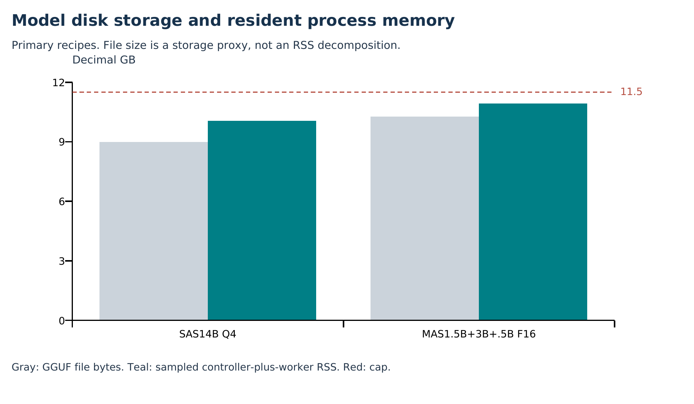

## 14. Hypothesis ledger and scientific originality

The prespecified goal that resident MAS should reduce wrong delivery without losing correct delivery is not supported by the primary16 GB result. Correct-delivery intervals favor SAS under both scoring conventions, while wrong-delivery counts favor a much more withholding MAS. This does not prove universal SAS superiority, accept a global null, establish equivalence, or validate regulatory safety.

The useful research contribution is a reproducible comparison of constrained deployment recipes, a coverage-aware interpretation, candidate/gate decomposition, metric-convention sensitivity and an honest repair/resource audit. No newly invented inference algorithm or globally novel feature is established. Engineering resumability, checksums and process-swap prevention support the measurement; they are not themselves evidence of algorithmic originality.

**Main head-to-head hypothesis:** the tested MAS recipe does not achieve fewer wrong deliveries without lost correct coverage. **Prompt bundle:** both systems show observed sample improvements over direct control, but this does not isolate the two prompt components. **Repair:** no no-loss/no-extra-error benefit is observed here. **RAM scaling law:** not identified by unlike cohorts/recipes. **Universal capacity floor:** not proven. **New algorithmic novelty:** not established.

## 15. A paper without32 GB: scope and remaining work

A <=16 GB manuscript can be drafted without32 GB if its claim is narrowed to the completed constrained deployment recipes and the documented development history. A third nominal tier is not logically required to report a reproducible negative/trade-off result. However, this package is a pre-paper research dossier, not a guarantee of acceptance or proof of a new algorithm.

The strongest defensible claims are: the tested16 GB SAS recipe delivers substantially more correct answers than the tested resident F16 MAS recipe; MAS's lower wrong count accompanies95% withholding; the observed MAS bottleneck is candidate production under this representation/profile; and this repair policy adds cost without a Pareto improvement. The candidate-only gate bound is exact for these fixed candidates. The wider architecture/precision/RAM conclusions remain unestablished.

Before claiming a clean product deployment, rerun the frozen primary pair from beginning to end under the same prospective no-swap service control, retaining the 11.5 GB ceiling, both metrics and all cases. No new method is required. For broader scientific claims, external report/benchmark or model-family replication and independent annotation/scoring review are more informative than retrospective significance hunting. Repeating a seed under deterministic greedy decoding is not an independent random replicate.

If32 GB is unavailable, do not invent its results or extrapolate a scaling curve from these confounded tiers. Present the unmeasured32 GB matrix as planned future work. Keep all failed resource attempts in the appendix, and keep theory conditional. A credible contribution may be empirical measurement and diagnosis; algorithmic novelty has not been demonstrated.

## 16. Limits and reproducibility

Only one model family, one fixed greedy recipe and one financial numerical benchmark are evaluated at 16 GB. The public development-source sample is report-held-out relative to recorded project exposure, not a clean pretraining holdout or the official FinQA test set. Equal memory/token ceilings do not match actual compute, prompt context, role allocation, training effort or latency.

MAS and SAS differ jointly in model size, precision, number of roles and internal prompts. The 8 GB redevelopment also differs in adaptation, serving mode, question source and CPU backend. Its deployment-budget label does not establish that adaptation training ran on a physically8 GB host. Neither arm is established as the best possible system under its memory ceiling. Consequently neither the 16 GB recipe contrast nor the cross-tier inventory identifies a universal architecture law, a pure precision effect or a causal RAM-scaling slope.

The resource history contains two swap failures; recovered accuracy evidence cannot certify an uninterrupted no-swap product. No bank-client, KYC mismatch or regulatory-safety endpoint is measured in the 16 GB FinQA study. The older synthetic tests do not establish real-world regulatory readiness either. The analysis is not legal or deployment certification.

The added tests, strata, cost sensitivities and theoretical framing are post hoc. They cannot manufacture a new algorithmic contribution or prove population equivalence. Some analytical intervals require independent reports/companies, and deterministic report selection limits design-based generalization. Theoretical results below are conditional mathematical statements about the formalized quantities, not proofs of empirical MAS inferiority.

Raw source authority is the immutable SSD run and its checksum-protected result archive. Derived case/report/paired tables are committed separately for analysis; no model weights, private tokens or training environment are copied into the documentation package. The final audit replay reconstructs prompts, programs, delivery decisions, scores and token ledgers from saved model responses. These reports introduce no new generation, training, thresholds, case exclusions or metric changes.

Run the reproducible scripts with a Python environment containing NumPy and ReportLab; the existing bundled desktop runtime supplies both. The analysis script verifies the final audit's input hashes and export checksum before recomputing endpoints. Rendering is a separate presentation step. See `research/tier16_v2/REPRODUCIBILITY.md` for exact commands and artifact maps.

## References and source hierarchy

- [R1] Chen et al. (2021), [FinQA: A Dataset of Numerical Reasoning over Financial Data](https://aclanthology.org/2021.emnlp-main.300/). Benchmark source; the project uses disclosed custom subsets and scoring conventions.
- [R2] Cameron and Miller (2015), [A Practitioner's Guide to Cluster-Robust Inference](https://cameron.econ.ucdavis.edu/research/Cameron_Miller_JHR_2015.pdf). Dependence-aware inference background.
- [R3] American Statistical Association (2016), [Statement on statistical significance and p-values](https://www.amstat.org/asa/files/pdfs/p-valuestatement.pdf). Interpret estimates and assumptions rather than a p-value threshold alone.
- [R4] Lakens (2017), [Equivalence Tests: A Practical Primer](https://doi.org/10.1177/1948550617697177). Equivalence requires an explicit margin and suitable design, not a nonsignificant difference.
- [R5] El-Yaniv and Wiener (2010), [On the Foundations of Noise-free Selective Classification](https://jmlr.org/papers/v11/el-yaniv10a.html). Risk/coverage and rejection are established ideas, not a new algorithm here.
- [R6] Holm (1979), [A Simple Sequentially Rejective Multiple Test Procedure](https://www.ime.usp.br/~abe/lista/pdf4R8xPVzCnX.pdf). Multiple-test control background.
- [R7] Hoeffding (1963), [Probability Inequalities for Sums of Bounded Random Variables](https://www.tandfonline.com/doi/abs/10.1080/01621459.1963.10500830). Independent bounded-cluster inequality background.
- [L1] Authoritative 16 GB audit: `AGERE/runs/lab_tiers_v1/lab-16-115gb-recovery-02/analysis/summary.json`; unchanged copy in `research/tier16_v2/evidence/original_audited_summary.json`.
- [L2] Final derived analysis: `research/tier16_v2/data/statistical_analysis.json`; file hashes and archive checksum in `research/tier16_v2/evidence/input_provenance.json`.
- [L3] Latest 8 GB natural runs: `AGERE/runs/tier8_method_qa/`; matched-study paired audits and secondary closure under `AGERE/runs/tier8_matched_continuation/` and `AGERE/runs/lab_handoff/closure-v1/`.
- [L4] Historical references: `TIER_8_RESEARCH_REPORT.md` and `TIER_8_V2_STATISTICAL_EVALUATION_REPORT.pdf`, retained unchanged. Their earlier snapshots and stronger interpretations do not supersede later raw evidence.
